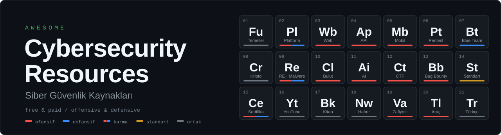

<h1 align="center"></h1>

Siber güvenlik kaynakları için küratörlü liste: ücretsiz ve ücretli eğitim platformları, lab'ler, YouTube kanalları, sertifikalar, standartlar ve araçlar. 
Ofansif (pentest, red team, bug bounty) ve defansif (SOC, DFIR, blue team) rollere göre filtrelenmiştir.

<b>Kapsam:</b> TryHackMe · Hack The Box · PortSwigger Web Security Academy · OWASP MASTG ve MASVS · HackTricks · MITRE ATT&amp;CK · CryptoHack · PentesterLab · Hackviser · HackingHub · Hacker101 · LiveOverflow · NetworkChuck · HackerSploit ve daha fazlası

Son gözden geçirme: Ekim 2026 · Fiyat ve plan bilgileri sık değişir; satın almadan önce resmi sayfayı kontrol edin.

🇬🇧 <a href="README.md">English version</a>

<a href="#roles">🧭 Role göre</a> ·
<a href="#ethics">⚖️ Etik</a> ·
<a href="#contributing">🤝 Katkı</a> ·
<a href="#license">📄 Lisans</a>

---

## 🗂️ İçindekiler

<table>
<tr><td align="center" width="33%"><a href="#fundamentals"><b>🎓 Temeller</b></a> 8 kaynak</td><td align="center" width="33%"><a href="#platforms"><b>🧪 Platformlar</b></a> 16 kaynak</td><td align="center" width="33%"><a href="#web"><b>🌐 Web</b></a> 11 kaynak</td></tr>
<tr><td align="center" width="33%"><a href="#api"><b>🔌 API</b></a> 6 kaynak</td><td align="center" width="33%"><a href="#mobile"><b>📱 Mobil</b></a> 12 kaynak</td><td align="center" width="33%"><a href="#pentest"><b>🎯 Pentest ve Red Team</b></a> 13 kaynak</td></tr>
<tr><td align="center" width="33%"><a href="#blue-team"><b>🛡️ Blue Team</b></a> 16 kaynak</td><td align="center" width="33%"><a href="#crypto"><b>🔐 Kripto</b></a> 7 kaynak</td><td align="center" width="33%"><a href="#reverse"><b>🔬 RE ve Malware</b></a> 12 kaynak</td></tr>
<tr><td align="center" width="33%"><a href="#cloud"><b>☁️ Bulut</b></a> 8 kaynak</td><td align="center" width="33%"><a href="#ai"><b>🤖 AI</b></a> 7 kaynak</td><td align="center" width="33%"><a href="#ctf"><b>🚩 CTF</b></a> 8 kaynak</td></tr>
<tr><td align="center" width="33%"><a href="#bug-bounty"><b>💰 Bug Bounty</b></a> 10 kaynak</td><td align="center" width="33%"><a href="#standards"><b>📐 Standartlar</b></a> 14 kaynak</td><td align="center" width="33%"><a href="#certs"><b>🏅 Sertifikalar</b></a> 20 kaynak</td></tr>
<tr><td align="center" width="33%"><a href="#youtube"><b>📺 YouTube</b></a> 19 kaynak</td><td align="center" width="33%"><a href="#books"><b>📚 Kitaplar</b></a> 12 kaynak</td><td align="center" width="33%"><a href="#news"><b>🎙️ Haber</b></a> 11 kaynak</td></tr>
<tr><td align="center" width="33%"><a href="#vuln-apps"><b>🐛 Zafiyetli Uygulamalar</b></a> 11 kaynak</td><td align="center" width="33%"><a href="#tools"><b>🧰 Araçlar</b></a> 13 kaynak</td><td align="center" width="33%"><a href="#turkish"><b>🇹🇷 Türkçe</b></a> 5 kaynak</td></tr>
</table>

---

## 📖 Okuma Rehberi

| Rozet | Anlamı |
|---|---|
| 🟢 **Ücretsiz** | İçeriğin tamamı ücretsiz erişilebilir (kayıt gerekebilir) |
| 🟡 **Freemium** | Ücretsiz katman var, tam erişim veya sertifika ücretli |
| 🔴 **Ücretli** | Satın alma / abonelik gerekir |

Her bölümde kaynaklar **🟢 Ücretsiz** ve **💳 Ücretli** olarak iki gruba ayrılmıştır. Ücretsiz katmanı da olan (freemium) kaynaklar Ücretli grupta yer alır ve 🟡 rozetiyle işaretlidir.

**Seviye:** Başlangıç · Orta · İleri. Aksi belirtilmedikçe içerik İngilizcedir.

**Yön / Rol:** Her satırda kaynağın hangi yöne ve role hitap ettiğini gösteren bir rozet var. GitHub'da `Ctrl+F` ile `⚔️ Pentest` veya `🛡️ SOC` yazarak hızlıca filtreleyebilirsiniz.

| Rozet | Yön | Kapsadığı roller |
|---|---|---|
| ⚔️ | **Ofansif** | Pentest, Web, Bug Bounty, Red Team, Exploit/RE, Mobil, API, Bulut, AI Red Team, CTF |
| 🛡️ | **Defansif** | SOC, DFIR, Tespit, Zararlı Analizi, AppSec, Zafiyet Yönetimi, Sertleştirme, Tehdit İstihbaratı, Bulut Güvenliği |
| ⚔️🛡️ | **Karma** | Hem ofansif hem defansif içerik (Purple Team yaklaşımı) |
| 🏛️ | **GRC** | Yönetişim, risk ve uyum |
| 🧩 | **Ortak** | Temeller, kriptografi, standartlar, haber ve genel kaynaklar |

---

## 🧭 Role Göre Hızlı Erişim

Bir rol seçin; ilgili bölümlere buradan gidin.

| Rol | Ne yapar | Bölümler |
| --- | --- | --- |
| ⚔️ Pentest | Ağ, sistem ve uygulamalara yetkili sızma testi | [🧪 Platformlar](#platforms) · [🎯 Pentest ve Red Team](#pentest) · [🐛 Zafiyetli Uygulamalar](#vuln-apps) |
| ⚔️ Web | Web uygulaması güvenlik testi | [🌐 Web](#web) · [🔌 API](#api) |
| ⚔️ Bug Bounty | Programlarda zafiyet avı | [💰 Bug Bounty](#bug-bounty) · [🌐 Web](#web) |
| ⚔️ Red Team | Gerçekçi saldırgan simülasyonu, Active Directory | [🎯 Pentest ve Red Team](#pentest) · [☁️ Bulut](#cloud) |
| ⚔️ Exploit / RE | Binary exploitation, tersine mühendislik | [🔬 RE ve Malware](#reverse) · [🚩 CTF](#ctf) |
| ⚔️ Mobil / API / Bulut | Platform odaklı ofansif test | [📱 Mobil](#mobile) · [🔌 API](#api) · [☁️ Bulut](#cloud) |
| ⚔️ AI Red Team | LLM ve AI sistemlerine saldırı testi | [🤖 AI](#ai) |
| 🛡️ SOC | Alarm triyajı, izleme, olay tespiti | [🛡️ Blue Team](#blue-team) |
| 🛡️ DFIR | Olay müdahalesi ve adli bilişim | [🛡️ Blue Team](#blue-team) |
| 🛡️ Tespit / Threat Hunting | Tespit kuralları ve tehdit avı | [🛡️ Blue Team](#blue-team) · [📐 Standartlar](#standards) |
| 🛡️ Zararlı Analizi | Zararlı yazılımı analiz etme | [🔬 RE ve Malware](#reverse) · [🛡️ Blue Team](#blue-team) |
| 🛡️ AppSec | Güvenli yazılım geliştirme ve kod inceleme | [🌐 Web](#web) · [📐 Standartlar](#standards) |
| 🏛️ GRC | Yönetişim, risk ve uyum | [📐 Standartlar](#standards) · [🏅 Sertifikalar](#certs) |
| ⚔️🛡️ Purple Team | Saldırı ve savunmayı birlikte yürütme | [🎯 Pentest ve Red Team](#pentest) · [🛡️ Blue Team](#blue-team) · [📐 Standartlar](#standards) |

---

## 🎓 Temeller ve Başlangıç

🟢 <b>6</b> ücretsiz · 💳 <b>2</b> ücretli · toplam <b>8</b> kaynak

### 🟢 Ücretsiz

| Kaynak | Yön / Rol | Tür | Fiyat | Seviye | Not |
| --- | --- | --- | --- | --- | --- |
| [Professor Messer](https://www.professormesser.com) | 🧩 Temel | Video | 🟢 | Başlangıç | CompTIA müfredatına uygun ağ ve güvenlik dersleri |
| [OverTheWire: Bandit](https://overthewire.org/wargames/) | 🧩 Temel | Wargame | 🟢 | Başlangıç | Linux komut satırı ve temel güvenlik becerileri |
| [Linux Journey](https://linuxjourney.com) | 🧩 Temel | Web | 🟢 | Başlangıç | Linux temelleri |
| [Hackviser CORE](https://hackviser.com/core) | 🧩 Temel | Sertifika | 🟢 | Başlangıç | Ücretsiz temel siber güvenlik sertifikası |
| [CS50P (Harvard)](https://cs50.harvard.edu/python/) | 🧩 Temel | Kurs | 🟢 | Başlangıç | Python temelleri; otomasyon ve araç yazmak için gerekli |
| [Automate the Boring Stuff with Python](https://automatetheboringstuff.com) | 🧩 Temel | Kitap | 🟢 | Başlangıç | Python ile pratik otomasyon |

### 💳 Ücretli

| Kaynak | Yön / Rol | Tür | Fiyat | Seviye | Not |
| --- | --- | --- | --- | --- | --- |
| [Cisco Networking Academy](https://www.netacad.com) | 🧩 Temel | Kurs | 🟡 | Başlangıç | Ağ ve siber güvenlik giriş kursları |
| [Google Cybersecurity Certificate](https://www.coursera.org/professional-certificates/google-cybersecurity) | 🧩 Temel | Kurs | 🔴 | Başlangıç | Coursera aboneliği gerekir; SOC odaklı giriş |

<a href="#top">↑ Başa dön</a>

---

## 🧪 Eğitim ve Lab Platformları

🟢 <b>6</b> ücretsiz · 💳 <b>10</b> ücretli · toplam <b>16</b> kaynak

### 🟢 Ücretsiz

| Kaynak | Yön / Rol | Fiyat | Seviye | Not |
| --- | --- | --- | --- | --- |
| [PortSwigger Web Security Academy](https://portswigger.net/web-security) | ⚔️ Web | 🟢 | Başlangıç–İleri | Burp Suite yapımcılarından web güvenliği; her zafiyet sınıfı için lab |
| [Hacker101](https://www.hacker101.com) | ⚔️ Bug Bounty | 🟢 | Başlangıç | HackerOne'ın web güvenliği sınıfı ve CTF'si |
| [pwn.college](https://pwn.college) | ⚔️ Exploit/RE | 🟢 | Orta–İleri | Arizona State University; binary exploitation ve sistem güvenliği |
| [picoCTF](https://picoctf.org) | ⚔️ CTF | 🟢 | Başlangıç | Carnegie Mellon; eğitim odaklı CTF platformu |
| [HackThisSite](https://www.hackthissite.org) | ⚔️ CTF | 🟢 | Başlangıç | Klasik ücretsiz hacking challenge sitesi |
| [VulnHub](https://www.vulnhub.com) | ⚔️ Pentest | 🟢 | Orta | İndirilebilir zafiyetli VM arşivi (yeni içerik akışı yavaşladı) |

### 💳 Ücretli

| Kaynak | Yön / Rol | Fiyat | Seviye | Not |
| --- | --- | --- | --- | --- |
| [TryHackMe](https://tryhackme.com) | ⚔️🛡️ Karma | 🟡 | Başlangıç–Orta | Rehberli odalar ve rol bazlı yollar. Ücretsiz kullanıcıda günlük VM süresi sınırlı, tam yollar Premium ile açılır |
| [Hack The Box (Labs)](https://www.hackthebox.com) | ⚔️ Pentest | 🟡 | Orta–İleri | Makineler, challenge'lar, Pro Labs, CTF. Ücretsiz katman + VIP/VIP+ |
| [HTB Academy](https://academy.hackthebox.com) | ⚔️🛡️ Karma | 🟡 | Başlangıç–İleri | Modüller ve rol yolları; "cubes" modeli, öğrenci planı ve sınav kuponları ayrı |
| [Hackviser](https://hackviser.com) | ⚔️🛡️ Karma | 🟡 | Başlangıç–Orta | Warmups, Labs, Scenarios ve tarayıcıda araç kutusu (HackerBox). CORE ücretsiz; CAPT, CWSE, CSOA ücretli |
| [HackingHub](https://www.hackinghub.io) | ⚔️ Bug Bounty | 🟡 | Orta | Bug bounty ve gerçek zafiyetlerden türetilmiş lab'ler; ücretsiz lab kütüphanesi + premium |
| [PentesterLab](https://pentesterlab.com) | ⚔️ Web | 🟡 | Orta | Ücretsiz egzersizler + PRO abonelik; web zafiyetleri ve kod inceleme |
| [Root-Me](https://www.root-me.org) | ⚔️ CTF | 🟡 | Başlangıç–İleri | Geniş challenge arşivi, topluluk odaklı |
| [TCM Security Academy](https://academy.tcm-sec.com) | ⚔️ Pentest | 🟡 | Başlangıç–Orta | Practical Ethical Hacking ve PNPT sertifikası |
| [OffSec](https://www.offsec.com) | ⚔️ Pentest | 🔴 | Orta–İleri | PEN-200 (OSCP), Proving Grounds ve ileri kurslar |
| [INE](https://ine.com) | ⚔️ Pentest | 🟡 | Başlangıç–İleri | eJPT ve eCPPT dahil sertifika yolları |

<a href="#top">↑ Başa dön</a>

---

## 🌐 Web Uygulama Güvenliği

🟢 <b>10</b> ücretsiz · 💳 <b>1</b> ücretli · toplam <b>11</b> kaynak

### 🟢 Ücretsiz

| Kaynak | Yön / Rol | Tür | Fiyat | Seviye | Not |
| --- | --- | --- | --- | --- | --- |
| [PortSwigger Web Security Academy](https://portswigger.net/web-security) | ⚔️ Web | Lab | 🟢 | Başlangıç–İleri | SQLi, XSS, SSRF, deserialization, request smuggling, LLM saldırıları ve daha fazlası |
| [OWASP Web Security Testing Guide](https://owasp.org/www-project-web-security-testing-guide/) | ⚔️ Web | Rehber | 🟢 | Orta | Web test metodolojisi |
| [OWASP Top 10](https://owasp.org/www-project-top-ten/) | 🧩 AppSec | Referans | 🟢 | Başlangıç | En yaygın web risklerinin listesi |
| [OWASP Cheat Sheet Series](https://cheatsheetseries.owasp.org) | 🛡️ AppSec | Referans | 🟢 | Tüm | Savunma odaklı pratik özetler |
| [OWASP ASVS](https://owasp.org/www-project-application-security-verification-standard/) | 🛡️ AppSec | Standart | 🟢 | Orta | Uygulama güvenlik doğrulama gereksinimleri |
| [The XSS Rat](https://www.youtube.com/@TheXSSrat) | ⚔️ Web | YouTube | 🟢 | Başlangıç–Orta | Bug bounty ve web zafiyetleri anlatımı |
| [Rana Khalil](https://www.youtube.com/@RanaKhalil101) | ⚔️ Web | YouTube | 🟢 | Orta | Web Security Academy lab çözümleri |
| [PwnFunction](https://www.youtube.com/@PwnFunction) | ⚔️ Web | YouTube | 🟢 | Başlangıç | Web zafiyetlerinin animasyonlu anlatımı |
| [PayloadsAllTheThings](https://github.com/swisskyrepo/PayloadsAllTheThings) | ⚔️ Web | Referans | 🟢 | Orta | Zafiyet sınıfı başına payload ve bypass koleksiyonu |
| [HackTricks – Pentesting Web](https://book.hacktricks.wiki) | ⚔️ Pentest | Wiki | 🟢 | Orta–İleri | Teknik ve metodoloji derlemesi |

### 💳 Ücretli

| Kaynak | Yön / Rol | Tür | Fiyat | Seviye | Not |
| --- | --- | --- | --- | --- | --- |
| [Burp Suite](https://portswigger.net/burp) | ⚔️ Web | Araç | 🟡 | Tüm | Community ücretsiz, Professional ücretli |

<a href="#top">↑ Başa dön</a>

---

## 🔌 API Güvenliği

🟢 <b>6</b> ücretsiz · toplam <b>6</b> kaynak

### 🟢 Ücretsiz

| Kaynak | Yön / Rol | Tür | Fiyat | Seviye | Not |
| --- | --- | --- | --- | --- | --- |
| [OWASP API Security Top 10](https://owasp.org/API-Security/) | 🧩 AppSec | Referans | 🟢 | Başlangıç | API'lere özgü risk listesi |
| [Damn Vulnerable RESTaurant](https://github.com/theowni/Damn-Vulnerable-RESTaurant-API-Game) | ⚔️🛡️ Karma | Lab | 🟢 | Başlangıç–Orta | Python FastAPI + PostgreSQL; saldır, tespit et ve düzelt. Docker veya GitHub Codespaces ile çalışır (GPL-3.0) |
| [OWASP crAPI](https://github.com/OWASP/crAPI) | ⚔️ API | Lab | 🟢 | Orta | Gerçekçi mikroservis tabanlı zafiyetli API |
| [VAmPI](https://github.com/erev0s/VAmPI) | ⚔️ API | Lab | 🟢 | Başlangıç | Zafiyetli REST API |
| [APIsec University](https://www.apisecuniversity.com) | ⚔️ API | Kurs | 🟢 | Başlangıç–Orta | Ücretsiz API güvenliği kursları |
| [PortSwigger: API testing](https://portswigger.net/web-security/api-testing) | ⚔️ API | Lab | 🟢 | Orta | API test teknikleri |

<a href="#top">↑ Başa dön</a>

---

## 📱 Mobil Uygulama Güvenliği

🟢 <b>11</b> ücretsiz · 💳 <b>1</b> ücretli · toplam <b>12</b> kaynak

> OWASP MASTG, 2026 Haziran'da yeniden yapılandırmasını tamamlayıp **v2.0.0** olarak yayımlandı; MASVS, MASWE ve MASTG artık birbirine bağlı çalışıyor.

### 🟢 Ücretsiz

| Kaynak | Yön / Rol | Tür | Fiyat | Seviye | Not |
| --- | --- | --- | --- | --- | --- |
| [OWASP MASVS](https://mas.owasp.org/MASVS/) | 🧩 Mobil | Standart | 🟢 | Orta | Mobil uygulama güvenlik doğrulama standardı (v2.0) |
| [OWASP MASTG](https://mas.owasp.org/MASTG/) | ⚔️ Mobil | Rehber | 🟢 | Orta–İleri | Android/iOS test prosedürleri, teknikler ve araçlar |
| [OWASP MASWE](https://mas.owasp.org/MASWE/) | 🧩 Mobil | Referans | 🟢 | Orta | Mobil zayıflık numaralandırması |
| [MAS Checklist](https://mas.owasp.org/checklists/) | 🧩 Mobil | Checklist | 🟢 | Orta | MASVS kontrol listesi |
| [MAS Crackmes (UnCrackable Apps)](https://mas.owasp.org/crackmes/) | ⚔️ Mobil | Lab | 🟢 | Orta–İleri | Tersine mühendislik ve dayanıklılık (resilience) pratiği |
| [DVIA-v2](https://github.com/prateek147/DVIA-v2) | ⚔️ Mobil | Lab | 🟢 | Başlangıç | Zafiyetli iOS uygulaması |
| [InsecureBankv2](https://github.com/dineshshetty/Android-InsecureBankv2) | ⚔️ Mobil | Lab | 🟢 | Başlangıç | Zafiyetli Android bankacılık uygulaması |
| [Frida](https://frida.re) | ⚔️ Mobil | Araç | 🟢 | Orta–İleri | Dinamik instrumentation |
| [objection](https://github.com/sensepost/objection) | ⚔️ Mobil | Araç | 🟢 | Orta | Frida tabanlı runtime inceleme |
| [MobSF](https://github.com/MobSF/Mobile-Security-Framework-MobSF) | ⚔️ Mobil | Araç | 🟢 | Başlangıç–Orta | Statik ve dinamik mobil analiz |
| [jadx](https://github.com/skylot/jadx) | ⚔️ Mobil | Araç | 🟢 | Orta | Android dekompilasyon |

### 💳 Ücretli

| Kaynak | Yön / Rol | Tür | Fiyat | Seviye | Not |
| --- | --- | --- | --- | --- | --- |
| [HackingHub](https://www.hackinghub.io) | ⚔️ Mobil | Platform | 🟡 | Orta | Android ve iOS lab'leri |

<a href="#top">↑ Başa dön</a>

---

## 🎯 Ağ, Pentest ve Red Team

🟢 <b>11</b> ücretsiz · 💳 <b>2</b> ücretli · toplam <b>13</b> kaynak

### 🟢 Ücretsiz

| Kaynak | Yön / Rol | Tür | Fiyat | Seviye | Not |
| --- | --- | --- | --- | --- | --- |
| [HackTricks](https://book.hacktricks.wiki) | ⚔️ Pentest | Wiki | 🟢 | Orta–İleri | Pentest teknikleri ansiklopedisi |
| [The Hacker Recipes](https://www.thehacker.recipes) | ⚔️ Red Team | Wiki | 🟢 | Orta–İleri | Active Directory ve ağ saldırı teknikleri |
| [ired.team](https://www.ired.team) | ⚔️ Red Team | Wiki | 🟢 | İleri | Red team notları |
| [ADSecurity.org](https://adsecurity.org) | ⚔️ Red Team | Blog | 🟢 | İleri | Active Directory güvenliği |
| [MITRE ATT&CK](https://attack.mitre.org) | 🧩 Tehdit Modeli | Referans | 🟢 | Tüm | Saldırgan taktik ve teknikleri bilgi tabanı |
| [IppSec](https://www.youtube.com/@ippsec) | ⚔️ Pentest | YouTube | 🟢 | Orta–İleri | HTB makine çözümleri ve metodoloji |
| [PTES](http://www.pentest-standard.org) | ⚔️ Pentest | Standart | 🟢 | Orta | Penetration Testing Execution Standard |
| [GTFOBins](https://gtfobins.github.io) | ⚔️ Pentest | Referans | 🟢 | Orta | Unix ikililerini kötüye kullanma teknikleri |
| [LOLBAS](https://lolbas-project.github.io) | ⚔️ Pentest | Referans | 🟢 | Orta | Windows "living off the land" ikilileri |
| [BloodHound](https://github.com/SpecterOps/BloodHound) | ⚔️ Red Team | Araç | 🟢 | Orta–İleri | AD saldırı yolu analizi |
| [Impacket](https://github.com/fortra/impacket) | ⚔️ Red Team | Araç | 🟢 | Orta–İleri | Ağ protokolleri için Python kütüphanesi |

### 💳 Ücretli

| Kaynak | Yön / Rol | Tür | Fiyat | Seviye | Not |
| --- | --- | --- | --- | --- | --- |
| [HackTricks Training](https://training.hacktricks.xyz) | ⚔️ Red Team | Eğitim | 🔴 | İleri | Cloud ve Linux odaklı red team eğitimleri |
| [HTB Pro Labs](https://www.hackthebox.com) | ⚔️ Red Team | Lab | 🔴 | İleri | Kurumsal ağ simülasyonları |

<a href="#top">↑ Başa dön</a>

---

## 🛡️ Blue Team, SOC ve DFIR

🟢 <b>7</b> ücretsiz · 💳 <b>9</b> ücretli · toplam <b>16</b> kaynak

> LetsDefend, 2025 Eylül'de Hack The Box tarafından satın alındı; içerik HTB ekosistemine entegre ediliyor.

### 🟢 Ücretsiz

| Kaynak | Yön / Rol | Tür | Fiyat | Seviye | Not |
| --- | --- | --- | --- | --- | --- |
| [MITRE D3FEND](https://d3fend.mitre.org) | 🛡️ Tespit | Referans | 🟢 | Orta | Savunma tekniklerinin bilgi grafiği |
| [Sigma](https://github.com/SigmaHQ/sigma) | 🛡️ Tespit | Araç | 🟢 | Orta | SIEM'den bağımsız tespit kuralı formatı |
| [Atomic Red Team](https://github.com/redcanaryco/atomic-red-team) | 🛡️ Tespit | Araç | 🟢 | Orta | ATT&CK eşlemeli tespit testleri |
| [Malware-Traffic-Analysis.net](https://www.malware-traffic-analysis.net) | 🛡️ DFIR | Arşiv | 🟢 | Orta | PCAP'li gerçek enfeksiyon analizleri ve alıştırmalar |
| [SANS Reading Room](https://www.sans.org/white-papers/) | 🛡️ DFIR | Makale | 🟢 | Orta–İleri | Ücretsiz teknik beyaz kitaplar |
| [13Cubed](https://www.youtube.com/@13Cubed) | 🛡️ DFIR | YouTube | 🟢 | Orta | DFIR ve olay müdahalesi |
| [Splunk](https://www.splunk.com) / [Elastic](https://www.elastic.co) ücretsiz eğitimleri | 🛡️ SOC | Eğitim | 🟢 | Başlangıç–Orta | SIEM ve log analizi becerisi için |

### 💳 Ücretli

| Kaynak | Yön / Rol | Tür | Fiyat | Seviye | Not |
| --- | --- | --- | --- | --- | --- |
| [TryHackMe SOC yolları](https://tryhackme.com) | 🛡️ SOC | Platform | 🟡 | Başlangıç–Orta | SOC Level 1, DFIR ve tehdit avcılığı yolları |
| [LetsDefend](https://letsdefend.io) | 🛡️ SOC | Platform | 🟡 | Başlangıç–Orta | Alarm triyajı ve SOC iş akışı simülasyonu |
| [CyberDefenders](https://cyberdefenders.org) | 🛡️ DFIR | Platform | 🟡 | Orta–İleri | Adli bilişim, ağ/disk/bellek forensics, tehdit avcılığı. CCDL sertifika yolu |
| [Blue Team Labs Online](https://blueteamlabs.online) | 🛡️ DFIR | Platform | 🟡 | Orta | Log analizi, bellek forensics, tehdit istihbaratı challenge'ları |
| [Security Blue Team](https://securityblue.team) | 🛡️ SOC | Eğitim | 🔴 | Başlangıç–Orta | BTL1 / BTL2 sertifika yolu |
| [HTB Academy – Defensive yolları](https://academy.hackthebox.com) | 🛡️ SOC | Platform | 🟡 | Orta | SOC analist ve DFIR modülleri, CDSA sertifikası |
| [Hackviser CSOA](https://hackviser.com) | 🛡️ SOC | Sertifika | 🔴 | Orta | SOC analisti sertifikası |
| [Security Onion](https://securityonionsolutions.com) | 🛡️ SOC | Araç | 🟡 | Orta | Açık kaynak ağ güvenliği izleme ve tehdit avcılığı |
| [SANS Institute](https://www.sans.org) | 🧩 Genel | Eğitim | 🔴 | Orta–İleri | GIAC sertifikaları; sektör standardı ama pahalı |

<a href="#top">↑ Başa dön</a>

---

## 🔐 Kriptografi

🟢 <b>4</b> ücretsiz · 💳 <b>3</b> ücretli · toplam <b>7</b> kaynak

### 🟢 Ücretsiz

| Kaynak | Yön / Rol | Tür | Fiyat | Seviye | Not |
| --- | --- | --- | --- | --- | --- |
| [CryptoHack](https://cryptohack.org) | 🧩 Kripto | Platform | 🟢 | Başlangıç–İleri | Etkileşimli kripto challenge'ları; oyunlaştırılmış |
| [Cryptopals](https://cryptopals.com) | 🧩 Kripto | Alıştırma | 🟢 | Orta–İleri | Gerçek kripto saldırılarını uygulayarak öğrenme |
| [Crypto 101](https://www.crypto101.io) | 🧩 Kripto | Kitap | 🟢 | Başlangıç | Ücretsiz giriş kitabı |
| [Practical Cryptography for Developers](https://cryptobook.nakov.com) | 🧩 Kripto | Kitap | 🟢 | Orta | Geliştirici odaklı pratik kriptografi |

### 💳 Ücretli

| Kaynak | Yön / Rol | Tür | Fiyat | Seviye | Not |
| --- | --- | --- | --- | --- | --- |
| [Cryptography I (Dan Boneh)](https://www.coursera.org/learn/crypto) | 🧩 Kripto | Kurs | 🟡 | Orta | Stanford; Coursera |
| Serious Cryptography (Aumasson) | 🧩 Kripto | Kitap | 🔴 | Orta | Modern kriptografiye uygulamalı giriş |
| Real-World Cryptography (David Wong) | 🧩 Kripto | Kitap | 🔴 | Orta | Gerçek sistemlerde kriptografi |

<a href="#top">↑ Başa dön</a>

---

## 🔬 Tersine Mühendislik, Zararlı Yazılım ve Exploit

🟢 <b>11</b> ücretsiz · 💳 <b>1</b> ücretli · toplam <b>12</b> kaynak

### 🟢 Ücretsiz

| Kaynak | Yön / Rol | Tür | Fiyat | Seviye | Not |
| --- | --- | --- | --- | --- | --- |
| [LiveOverflow](https://www.youtube.com/@LiveOverflow) | ⚔️ Exploit/RE | YouTube | 🟢 | Başlangıç–İleri | Binary exploitation, tersine mühendislik, CTF ve web |
| [pwn.college](https://pwn.college) | ⚔️ Exploit/RE | Platform | 🟢 | Orta–İleri | Sistematik exploit geliştirme müfredatı |
| [Nightmare](https://guyinatuxedo.github.io) | ⚔️ Exploit/RE | Kurs | 🟢 | Orta | CTF odaklı binary exploitation |
| [ROP Emporium](https://ropemporium.com) | ⚔️ Exploit/RE | Alıştırma | 🟢 | Orta–İleri | ROP zinciri alıştırmaları |
| [Exploit Education](https://exploit.education) | ⚔️ Exploit/RE | Lab | 🟢 | Orta | Exploit geliştirme için zafiyetli VM'ler |
| [Malware Unicorn](https://malwareunicorn.org) | 🛡️ Zararlı Analizi | Workshop | 🟢 | Orta | Tersine mühendislik ve zararlı analizi atölyeleri |
| [OALabs](https://www.youtube.com/@OALABS) | 🛡️ Zararlı Analizi | YouTube | 🟢 | Orta–İleri | Zararlı yazılım analizi |
| [OpenSecurityTraining2](https://ost2.fyi) | ⚔️ Exploit/RE | Kurs | 🟢 | Orta–İleri | Ücretsiz ileri düzey güvenlik dersleri |
| [Azeria Labs](https://azeria-labs.com) | ⚔️ Exploit/RE | Eğitim | 🟢 | Orta | ARM assembly ve exploit |
| [Crackmes.one](https://crackmes.one) | ⚔️ Exploit/RE | Alıştırma | 🟢 | Başlangıç–İleri | Topluluk crackme arşivi |
| [Ghidra](https://ghidra-sre.org) | 🧩 Tersine Müh. | Araç | 🟢 | Orta | NSA'in açık kaynak tersine mühendislik aracı |

### 💳 Ücretli

| Kaynak | Yön / Rol | Tür | Fiyat | Seviye | Not |
| --- | --- | --- | --- | --- | --- |
| [ANY.RUN](https://any.run) | 🛡️ Zararlı Analizi | Sandbox | 🟡 | Orta | Etkileşimli zararlı yazılım sandbox'ı |

<a href="#top">↑ Başa dön</a>

---

## ☁️ Bulut ve Konteyner Güvenliği

🟢 <b>5</b> ücretsiz · 💳 <b>3</b> ücretli · toplam <b>8</b> kaynak

### 🟢 Ücretsiz

| Kaynak | Yön / Rol | Tür | Fiyat | Seviye | Not |
| --- | --- | --- | --- | --- | --- |
| [flAWS](http://flaws.cloud) / [flAWS2](http://flaws2.cloud) | ⚔️ Bulut | Lab | 🟢 | Başlangıç–Orta | AWS yanlış yapılandırma challenge'ları |
| [CloudGoat](https://github.com/RhinoSecurityLabs/cloudgoat) | ⚔️ Bulut | Lab | 🟢 | Orta | Zafiyetli AWS ortamı dağıtımı |
| [Hacking the Cloud](https://hackingthe.cloud) | ⚔️ Bulut | Wiki | 🟢 | Orta–İleri | Bulut saldırı teknikleri ansiklopedisi |
| [HackTricks Cloud](https://cloud.hacktricks.wiki) | ⚔️ Bulut | Wiki | 🟢 | Orta–İleri | AWS, GCP, Azure ve CI/CD pentest teknikleri |
| [Kubernetes Goat](https://github.com/madhuakula/kubernetes-goat) | ⚔️ Bulut | Lab | 🟢 | Orta | Zafiyetli Kubernetes ortamı |

### 💳 Ücretli

| Kaynak | Yön / Rol | Tür | Fiyat | Seviye | Not |
| --- | --- | --- | --- | --- | --- |
| [HackTricks Training (ARTE, GRTE, AzRTE)](https://training.hacktricks.xyz) | ⚔️ Bulut | Eğitim | 🔴 | İleri | AWS, GCP ve Azure red team uzmanlık eğitimleri |
| [Pwned Labs](https://pwnedlabs.io) | ⚔️ Bulut | Platform | 🟡 | Orta–İleri | Bulut odaklı gerçekçi lab'ler |
| [AWS Skill Builder](https://skillbuilder.aws) | 🛡️ Bulut Güvenliği | Eğitim | 🟡 | Başlangıç–Orta | Ücretsiz temel güvenlik içeriği, bazı kurslar ücretli |

<a href="#top">↑ Başa dön</a>

---

## 🤖 Yapay Zekâ ve LLM Güvenliği

🟢 <b>6</b> ücretsiz · 💳 <b>1</b> ücretli · toplam <b>7</b> kaynak

### 🟢 Ücretsiz

| Kaynak | Yön / Rol | Tür | Fiyat | Seviye | Not |
| --- | --- | --- | --- | --- | --- |
| [OWASP GenAI Security Project](https://genai.owasp.org) | 🧩 AI Güvenliği | Referans | 🟢 | Başlangıç–Orta | LLM Top 10 (2026 sürümü yayımlandı), Agentic AI Top 10 ve GenAI Red Teaming Guide |
| [GenAI Red Team Lab](https://github.com/GenAI-Security-Project/GenAI-Red-Team-Lab) | ⚔️ AI Red Team | Lab | 🟢 | Orta | OWASP'ın LLM red team sandbox'ı ve örnekleri |
| [MITRE ATLAS](https://atlas.mitre.org) | 🧩 AI Güvenliği | Referans | 🟢 | Orta | AI sistemlerine yönelik saldırı taktikleri |
| [PortSwigger: LLM attacks](https://portswigger.net/web-security/llm-attacks) | ⚔️ AI Red Team | Lab | 🟢 | Orta | Prompt injection ve LLM API istismarı |
| [Gandalf (Lakera)](https://gandalf.lakera.ai) | ⚔️ AI Red Team | Oyun | 🟢 | Başlangıç | Prompt injection pratiği |
| [awesome-ai-security](https://github.com/ottosulin/awesome-ai-security) | 🧩 AI Güvenliği | Liste | 🟢 | Tüm | Çerçeve, araç ve öğrenme kaynakları derlemesi |

### 💳 Ücretli

| Kaynak | Yön / Rol | Tür | Fiyat | Seviye | Not |
| --- | --- | --- | --- | --- | --- |
| [Crucible (Dreadnode)](https://crucible.dreadnode.io) | ⚔️ AI Red Team | Platform | 🟡 | Orta | AI/ML güvenliği challenge'ları |

<a href="#top">↑ Başa dön</a>

---

## 🚩 CTF ve Yarışmalar

🟢 <b>6</b> ücretsiz · 💳 <b>2</b> ücretli · toplam <b>8</b> kaynak

### 🟢 Ücretsiz

| Kaynak | Yön / Rol | Fiyat | Seviye | Not |
| --- | --- | --- | --- | --- |
| [CTFtime](https://ctftime.org) | ⚔️ CTF | 🟢 | Tüm | Dünya CTF takvimi ve takım sıralamaları |
| [picoCTF](https://picoctf.org) | ⚔️ CTF | 🟢 | Başlangıç | Yıl boyu açık pratik arşivi |
| [OverTheWire](https://overthewire.org/wargames/) | ⚔️ CTF | 🟢 | Başlangıç–İleri | Wargame serisi (Bandit, Leviathan, Natas vb.) |
| [CryptoHack](https://cryptohack.org) | ⚔️ CTF | 🟢 | Başlangıç–İleri | Kripto odaklı |
| [Hacker101 CTF](https://www.hacker101.com) | ⚔️ CTF | 🟢 | Başlangıç | Yeterli puan toplayınca özel bug bounty programı davetleri |
| [TEKNOFEST Siber Güvenlik yarışmaları](https://www.teknofest.org) | ⚔️ CTF | 🟢 | Orta | Türkiye'de düzenlenen ulusal yarışmalar; duyurular resmi TEKNOFEST kanallarından |

### 💳 Ücretli

| Kaynak | Yön / Rol | Fiyat | Seviye | Not |
| --- | --- | --- | --- | --- |
| [Root-Me](https://www.root-me.org) | ⚔️ CTF | 🟡 | Başlangıç–İleri | Çok kategorili challenge'lar |
| [HTB CTF'leri](https://ctf.hackthebox.com) | ⚔️ CTF | 🟡 | Orta–İleri | Takım ve üniversite CTF'leri |

<a href="#top">↑ Başa dön</a>

---

## 💰 Bug Bounty ve Zafiyet Avı

🟢 <b>10</b> ücretsiz · toplam <b>10</b> kaynak

### 🟢 Ücretsiz

| Kaynak | Yön / Rol | Tür | Fiyat | Seviye | Not |
| --- | --- | --- | --- | --- | --- |
| [HackerOne](https://www.hackerone.com) | ⚔️ Bug Bounty | Platform | 🟢 | Tüm | Bug bounty platformu; [Hacktivity](https://hackerone.com/hacktivity) kamuya açık raporlar |
| [Bugcrowd](https://www.bugcrowd.com) | ⚔️ Bug Bounty | Platform | 🟢 | Tüm | Bug bounty ve VDP programları |
| [Intigriti](https://www.intigriti.com) | ⚔️ Bug Bounty | Platform | 🟢 | Tüm | Avrupa merkezli bug bounty platformu |
| [YesWeHack](https://www.yeswehack.com) | ⚔️ Bug Bounty | Platform | 🟢 | Tüm | Avrupa merkezli bug bounty platformu |
| [Pentester Land](https://pentester.land) | ⚔️ Bug Bounty | Arşiv | 🟢 | Orta | Bug bounty writeup ve kaynak listesi |
| [Critical Thinking – Bug Bounty Podcast](https://www.criticalthinkingpodcast.io) | ⚔️ Bug Bounty | Podcast | 🟢 | Orta–İleri | Teknik bug bounty sohbetleri |
| [NahamSec](https://www.youtube.com/@NahamSec) | ⚔️ Bug Bounty | YouTube | 🟢 | Başlangıç–Orta | Bug bounty ve recon |
| [STÖK](https://www.youtube.com/@STOKfredrik) | ⚔️ Bug Bounty | YouTube | 🟢 | Orta | Bug bounty ve araç incelemeleri |
| [InsiderPhD](https://www.youtube.com/@InsiderPhD) | ⚔️ Bug Bounty | YouTube | 🟢 | Başlangıç | Yeni başlayanlar için bug bounty anlatımı |
| [Bug Bounty Reports Explained](https://www.youtube.com/@BugBountyReportsExplained) | ⚔️ Bug Bounty | YouTube | 🟢 | Orta | Gerçek raporların analizi |

<a href="#top">↑ Başa dön</a>

---

## 📐 Standartlar ve Çerçeveler

🟢 <b>12</b> ücretsiz · 💳 <b>2</b> ücretli · toplam <b>14</b> kaynak

### 🟢 Ücretsiz

| Kaynak | Yön / Rol | Alan | Fiyat | Not |
| --- | --- | --- | --- | --- |
| [MITRE ATT&CK](https://attack.mitre.org) | 🧩 Tehdit Modeli | Tehdit modelleme | 🟢 | Saldırgan taktik ve teknikleri |
| [MITRE D3FEND](https://d3fend.mitre.org) | 🛡️ Tespit | Savunma | 🟢 | Savunma teknikleri bilgi grafiği |
| [MITRE ATLAS](https://atlas.mitre.org) | 🧩 AI Güvenliği | AI güvenliği | 🟢 | AI sistemlerine yönelik saldırılar |
| [MITRE CAPEC](https://capec.mitre.org) | 🧩 Tehdit Modeli | Saldırı kalıpları | 🟢 | Yaygın saldırı kalıpları kataloğu |
| [CWE](https://cwe.mitre.org) | 🧩 AppSec | Zayıflıklar | 🟢 | Yazılım zayıflık numaralandırması |
| [CVE](https://www.cve.org) / [NVD](https://nvd.nist.gov) | 🛡️ Zafiyet Yön. | Zafiyetler | 🟢 | Zafiyet kimlikleri ve veritabanı |
| [CISA KEV](https://www.cisa.gov/known-exploited-vulnerabilities-catalog) | 🛡️ Zafiyet Yön. | Zafiyetler | 🟢 | Aktif olarak istismar edilen zafiyetler kataloğu |
| [EPSS](https://www.first.org/epss/) | 🛡️ Zafiyet Yön. | Risk önceliklendirme | 🟢 | İstismar olasılığı skoru |
| [NIST Cybersecurity Framework](https://www.nist.gov/cyberframework) | 🏛️ GRC | Yönetişim | 🟢 | CSF 2.0 |
| [OWASP SAMM](https://owaspsamm.org) | 🛡️ AppSec | Güvenli yazılım | 🟢 | Yazılım güvence olgunluk modeli |
| [OWASP MASVS](https://mas.owasp.org/MASVS/) | 🧩 Mobil | Mobil | 🟢 | Mobil güvenlik doğrulama standardı |
| [OWASP ASVS](https://owasp.org/www-project-application-security-verification-standard/) | 🛡️ AppSec | Web | 🟢 | Uygulama güvenlik doğrulama standardı |

### 💳 Ücretli

| Kaynak | Yön / Rol | Alan | Fiyat | Not |
| --- | --- | --- | --- | --- |
| [CIS Controls / Benchmarks](https://www.cisecurity.org) | 🛡️ Sertleştirme | Sertleştirme | 🟡 | Ücretsiz PDF'ler, ek araçlar üyelikle |
| ISO/IEC 27001 | 🏛️ GRC | Yönetim sistemi | 🔴 | Standart metni ücretli |

<a href="#top">↑ Başa dön</a>

---

## 🏅 Sertifikalar

🟢 <b>1</b> ücretsiz · 💳 <b>19</b> ücretli · toplam <b>20</b> kaynak

> Tüm sınav ücretleri ve paketler değişkendir; resmi sayfadan doğrulayın. Pratik (uygulamalı) sınavlar genellikle işverenler nezdinde daha çok değer görür.

### 🟢 Ücretsiz

| Sertifika | Yön / Rol | Veren | Odak | Fiyat | Seviye |
| --- | --- | --- | --- | --- | --- |
| CORE | 🧩 Temel | Hackviser | Temel siber güvenlik | 🟢 | Başlangıç |

### 💳 Ücretli

| Sertifika | Yön / Rol | Veren | Odak | Fiyat | Seviye |
| --- | --- | --- | --- | --- | --- |
| CAPT / CWSE / CSOA | ⚔️🛡️ Karma | Hackviser | Pentest, web, SOC | 🔴 | Orta |
| PT1 / SAL1 | ⚔️🛡️ Karma | TryHackMe | Pentest, SOC | 🔴 | Başlangıç–Orta |
| eJPT / eCPPT | ⚔️ Pentest | INE | Junior pentest | 🔴 | Başlangıç–Orta |
| PNPT | ⚔️ Pentest | TCM Security | Uygulamalı pentest + rapor | 🔴 | Orta |
| CPTS | ⚔️ Pentest | Hack The Box | Pentest | 🔴 | Orta–İleri |
| CBBH (CWES) | ⚔️ Web | Hack The Box | Web | 🔴 | Orta |
| CDSA | 🛡️ SOC | Hack The Box | SOC / savunma | 🔴 | Orta |
| CWEE | ⚔️ Web | Hack The Box | İleri web exploitation | 🔴 | İleri |
| BSCP | ⚔️ Web | PortSwigger | Burp ile web güvenliği | 🔴 | Orta |
| BTL1 / BTL2 | 🛡️ SOC | Security Blue Team | SOC / IR | 🔴 | Başlangıç–Orta |
| CCDL1 / CCDL2 | 🛡️ DFIR | CyberDefenders | Blue team | 🔴 | Orta |
| OSCP / OSCP+ | ⚔️ Pentest | OffSec | Pentest | 🔴 | Orta–İleri |
| OSEP / OSWE / OSED | ⚔️ Red Team | OffSec | Red team / web / exploit dev | 🔴 | İleri |
| CRTO | ⚔️ Red Team | Zero-Point Security | Red team operasyonu | 🔴 | Orta–İleri |
| GPEN / GCIH / GCFA vb. | ⚔️🛡️ Karma | SANS / GIAC | Pentest, IR, adli bilişim | 🔴 | Orta–İleri |
| Security+ / Network+ / PenTest+ | 🧩 Temel | CompTIA | Genel temel | 🔴 | Başlangıç |
| CISSP | 🏛️ GRC | ISC2 | Yönetim ve mimari | 🔴 | İleri |
| CISM / CISA | 🏛️ GRC | ISACA | Yönetişim / denetim | 🔴 | İleri |
| CEH | ⚔️ Pentest | EC-Council | Genel etik hacking | 🔴 | Başlangıç–Orta (ihale ve İK gereksinimlerinde yaygın) |

<a href="#top">↑ Başa dön</a>

---

## 📺 YouTube Kanalları

🟢 <b>19</b> ücretsiz · toplam <b>19</b> kaynak

### 🟢 Ücretsiz

| Kanal | Yön / Rol | Odak | Seviye |
| --- | --- | --- | --- |
| [NetworkChuck](https://www.youtube.com/@NetworkChuck) | 🧩 Temel | Ağ, Linux ve etik hacking'e giriş | Başlangıç |
| [HackerSploit](https://www.youtube.com/@HackerSploit) | ⚔️ Pentest | Pentest araçları, metodoloji, Linux | Başlangıç–Orta |
| [The XSS Rat](https://www.youtube.com/@TheXSSrat) | ⚔️ Web | Web zafiyetleri ve bug bounty | Başlangıç–Orta |
| [LiveOverflow](https://www.youtube.com/@LiveOverflow) | ⚔️ Exploit/RE | Binary exploitation, tersine mühendislik, web | Orta–İleri |
| [IppSec](https://www.youtube.com/@ippsec) | ⚔️ Pentest | HTB makine çözümleri | Orta–İleri |
| [John Hammond](https://www.youtube.com/@_JohnHammond) | ⚔️🛡️ Karma | CTF, malware, siber haberler | Başlangıç–Orta |
| [David Bombal](https://www.youtube.com/@davidbombal) | 🧩 Temel | Ağ, siber güvenlik, röportajlar | Başlangıç–Orta |
| [The Cyber Mentor (TCM)](https://www.youtube.com/@TCMSecurityAcademy) | ⚔️ Pentest | Pentest, AD, kariyer | Başlangıç–Orta |
| [Black Hills Information Security](https://www.youtube.com/@BlackHillsInformationSecurity) | ⚔️🛡️ Karma | Pentest, SOC, webcast'ler | Orta |
| [13Cubed](https://www.youtube.com/@13Cubed) | 🛡️ DFIR | DFIR | Orta |
| [OALabs](https://www.youtube.com/@OALABS) | 🛡️ Zararlı Analizi | Zararlı yazılım analizi | Orta–İleri |
| [Professor Messer](https://www.youtube.com/@professormesser) | 🧩 Temel | CompTIA temelleri | Başlangıç |
| [NahamSec](https://www.youtube.com/@NahamSec) | ⚔️ Bug Bounty | Bug bounty | Başlangıç–Orta |
| [STÖK](https://www.youtube.com/@STOKfredrik) | ⚔️ Bug Bounty | Bug bounty | Orta |
| [InsiderPhD](https://www.youtube.com/@InsiderPhD) | ⚔️ Bug Bounty | Bug bounty başlangıç | Başlangıç |
| [Bug Bounty Reports Explained](https://www.youtube.com/@BugBountyReportsExplained) | ⚔️ Bug Bounty | Rapor analizleri | Orta |
| [PwnFunction](https://www.youtube.com/@PwnFunction) | ⚔️ Web | Animasyonlu zafiyet anlatımı | Başlangıç |
| [Rana Khalil](https://www.youtube.com/@RanaKhalil101) | ⚔️ Web | Web Security Academy çözümleri | Orta |
| [Computerphile](https://www.youtube.com/@Computerphile) | 🧩 Temel | Bilgisayar bilimi ve güvenlik kavramları | Başlangıç |

<a href="#top">↑ Başa dön</a>

---

## 📚 Kitaplar

🟢 <b>2</b> ücretsiz · 💳 <b>10</b> ücretli · toplam <b>12</b> kaynak

### 🟢 Ücretsiz

| Kitap | Yön / Rol | Alan | Fiyat | Seviye |
| --- | --- | --- | --- | --- |
| Security Engineering (Ross Anderson) | 🧩 Genel | Sistem güvenliği | 🟢 | Orta–İleri (yazar ücretsiz çevrim içi yayımlıyor) |
| [Crypto 101](https://www.crypto101.io) | 🧩 Kripto | Kriptografi | 🟢 | Başlangıç |

### 💳 Ücretli

| Kitap | Yön / Rol | Alan | Fiyat | Seviye |
| --- | --- | --- | --- | --- |
| Hacking: The Art of Exploitation (Jon Erickson) | ⚔️ Exploit/RE | Exploit, C, assembly | 🔴 | Orta |
| The Web Application Hacker's Handbook (Stuttard, Pinto) | ⚔️ Web | Web (klasik, kısmen eski) | 🔴 | Orta |
| Bug Bounty Bootcamp (Vickie Li) | ⚔️ Bug Bounty | Bug bounty | 🔴 | Başlangıç–Orta |
| Real-World Bug Hunting (Peter Yaworski) | ⚔️ Bug Bounty | Bug bounty | 🔴 | Başlangıç |
| The Tangled Web (Michal Zalewski) | ⚔️ Web | Tarayıcı güvenliği | 🔴 | Orta |
| Practical Malware Analysis (Sikorski, Honig) | 🛡️ Zararlı Analizi | Zararlı analizi | 🔴 | Orta |
| Practical Binary Analysis (Dennis Andriesse) | ⚔️🛡️ Karma | İkili analiz | 🔴 | Orta–İleri |
| The Hacker Playbook 3 (Peter Kim) | ⚔️ Red Team | Pentest / red team | 🔴 | Orta |
| Red Team Field Manual (RTFM) | ⚔️ Red Team | Red team komut referansı | 🔴 | Orta |
| Black Hat Python (Justin Seitz) | ⚔️ Pentest | Python ile güvenlik araçları | 🔴 | Orta |

<a href="#top">↑ Başa dön</a>

---

## 🎙️ Podcast, Haber ve Bültenler

🟢 <b>11</b> ücretsiz · toplam <b>11</b> kaynak

### 🟢 Ücretsiz

| Kaynak | Yön / Rol | Tür | Fiyat | Not |
| --- | --- | --- | --- | --- |
| [Darknet Diaries](https://darknetdiaries.com) | 🧩 Haber | Podcast | 🟢 | Gerçek siber olay hikâyeleri |
| [Risky Business](https://risky.biz) | 🧩 Haber | Podcast | 🟢 | Haftalık sektör haberleri |
| [Critical Thinking](https://www.criticalthinkingpodcast.io) | ⚔️ Bug Bounty | Podcast | 🟢 | Bug bounty ve araştırma |
| [tl;dr sec](https://tldrsec.com) | 🧩 Haber | Bülten | 🟢 | Haftalık güvenlik araştırması özeti |
| [The Hacker News](https://thehackernews.com) | 🧩 Haber | Haber | 🟢 | Siber haberler |
| [BleepingComputer](https://www.bleepingcomputer.com) | 🧩 Haber | Haber | 🟢 | Fidye yazılımı, zafiyet, olay haberleri |
| [Krebs on Security](https://krebsonsecurity.com) | 🧩 Haber | Blog | 🟢 | Araştırmacı gazetecilik |
| [Schneier on Security](https://www.schneier.com) | 🧩 Haber | Blog | 🟢 | Güvenlik ve toplum analizi |
| [PortSwigger Research](https://portswigger.net/research) | ⚔️ Web | Blog | 🟢 | Web güvenliği araştırmaları |
| [Google Project Zero](https://googleprojectzero.blogspot.com) | ⚔️ Exploit/RE | Blog | 🟢 | İleri düzey zafiyet araştırmaları |
| [The Record](https://therecord.media) | 🧩 Haber | Haber | 🟢 | Siber politika ve olay haberleri |

<a href="#top">↑ Başa dön</a>

---

## 🐛 Zafiyetli Uygulamalar

🟢 <b>11</b> ücretsiz · toplam <b>11</b> kaynak

> Başlangıç noktası: [OWASP Vulnerable Web Applications Directory](https://owasp.org/www-project-vulnerable-web-applications-directory) — yüzlerce bilinçli zafiyetli uygulamanın listesi.

### 🟢 Ücretsiz

| Kaynak | Yön / Rol | Alan | Not |
| --- | --- | --- | --- |
| [DVWA](https://github.com/digininja/DVWA) | ⚔️ Web | Web | Klasik başlangıç uygulaması |
| [OWASP Juice Shop](https://owasp.org/www-project-juice-shop/) | ⚔️ Web | Web | Modern, oyunlaştırılmış zafiyetli e-ticaret uygulaması |
| [OWASP WebGoat](https://owasp.org/www-project-webgoat/) | ⚔️ Web | Web | Java; öğretici dersler |
| [OWASP Security Shepherd](https://owasp.org/www-project-security-shepherd/) | ⚔️ Web | Web / Mobil | Güvenlik farkındalığı ve eğitim platformu |
| [Damn Vulnerable RESTaurant](https://github.com/theowni/Damn-Vulnerable-RESTaurant-API-Game) | ⚔️ API | API | FastAPI tabanlı API oyunu |
| [OWASP crAPI](https://github.com/OWASP/crAPI) | ⚔️ API | API | Mikroservis tabanlı zafiyetli API |
| [DVIA-v2](https://github.com/prateek147/DVIA-v2) | ⚔️ Mobil | iOS | Zafiyetli iOS uygulaması |
| [Vulhub](https://github.com/vulhub/vulhub) | ⚔️ Pentest | CVE | Docker ile hazır CVE ortamları |
| [Kubernetes Goat](https://github.com/madhuakula/kubernetes-goat) | ⚔️ Bulut | Konteyner | Zafiyetli Kubernetes senaryoları |
| [CloudGoat](https://github.com/RhinoSecurityLabs/cloudgoat) | ⚔️ Bulut | Bulut | Zafiyetli AWS dağıtımı |
| [VulnHub](https://www.vulnhub.com) | ⚔️ Pentest | VM | İndirilebilir zafiyetli sanal makineler |

<a href="#top">↑ Başa dön</a>

---

## 🧰 Araçlar

🟢 <b>11</b> ücretsiz · 💳 <b>2</b> ücretli · toplam <b>13</b> kaynak

### 🟢 Ücretsiz

| Araç | Yön / Rol | Alan | Fiyat |
| --- | --- | --- | --- |
| [Kali Linux](https://www.kali.org) | ⚔️ Pentest | Pentest dağıtımı | 🟢 |
| [OWASP ZAP](https://www.zaproxy.org) | ⚔️ Web | Web tarayıcı / proxy | 🟢 |
| [Nmap](https://nmap.org) | ⚔️ Pentest | Ağ keşfi | 🟢 |
| [Wireshark](https://www.wireshark.org) | 🧩 Ağ Analizi | Paket analizi | 🟢 |
| [Ghidra](https://ghidra-sre.org) | 🧩 Tersine Müh. | Tersine mühendislik | 🟢 |
| [Frida](https://frida.re) | ⚔️ Mobil | Dinamik instrumentation | 🟢 |
| [CyberChef](https://gchq.github.io/CyberChef/) | 🧩 Genel | Veri dönüştürme / kodlama | 🟢 |
| [SecLists](https://github.com/danielmiessler/SecLists) | ⚔️ Pentest | Wordlist koleksiyonu | 🟢 |
| [PayloadsAllTheThings](https://github.com/swisskyrepo/PayloadsAllTheThings) | ⚔️ Web | Payload referansı | 🟢 |
| [GTFOBins](https://gtfobins.github.io) / [LOLBAS](https://lolbas-project.github.io) | ⚔️ Pentest | Yetki yükseltme referansı | 🟢 |
| [revshells.com](https://www.revshells.com) | ⚔️ Pentest | Reverse shell üreteci | 🟢 |

### 💳 Ücretli

| Araç | Yön / Rol | Alan | Fiyat |
| --- | --- | --- | --- |
| [Burp Suite](https://portswigger.net/burp) | ⚔️ Web | Web proxy / tarayıcı | 🟡 |
| [Metasploit Framework](https://www.metasploit.com) | ⚔️ Pentest | Exploit framework | 🟡 |

<a href="#top">↑ Başa dön</a>

---

## 🇹🇷 Türkçe Kaynaklar

🟢 <b>4</b> ücretsiz · 💳 <b>1</b> ücretli · toplam <b>5</b> kaynak

### 🟢 Ücretsiz

| Kaynak | Yön / Rol | Tür | Fiyat | Not |
| --- | --- | --- | --- | --- |
| [BTK Akademi](https://www.btkakademi.gov.tr) | 🧩 Temel | Eğitim portalı | 🟢 | BTK'nın ücretsiz çevrim içi eğitim platformu; siber güvenlik dahil birçok alanda eğitim ve sertifika |
| Siber Vatan Programı | 🧩 Genel | Program | 🟢 | Üniversite öğrencileri için kalkınma ajansları ve kurumlar aracılığıyla yürütülen siber güvenlik eğitimi; başvurular ilgili kurumların duyurularından takip edilir |
| [USOM](https://www.usom.gov.tr) | 🛡️ Tehdit İst. | Kurum | 🟢 | Ulusal Siber Olaylara Müdahale Merkezi; zararlı bağlantı ve tehdit bildirimleri |
| [techcareer.net – Siber Güvenliğe Giriş](https://www.techcareer.net/courses/siber-guvenlik) | 🧩 Temel | Kurs | 🟢 | Türkçe, 6 saatlik başlangıç kursu (Cisco sınıfı üzerinden) |

### 💳 Ücretli

| Kaynak | Yön / Rol | Tür | Fiyat | Not |
| --- | --- | --- | --- | --- |
| [Hackviser](https://hackviser.com) | ⚔️🛡️ Karma | Platform | 🟡 | Hands-on lab ve sertifika platformu; topluluk Discord ve Telegram kanalları aktif |

> Türkçe kaynak önerileriniz için PR açın; bu bölüm topluluk katkısıyla büyüyecek.

<a href="#top">↑ Başa dön</a>

---

## ⚖️ Etik ve Yasal Uyarı

Bu listedeki kaynaklar **yalnızca eğitim ve yetkili güvenlik testi** amacıyla derlenmiştir.

- Sadece kendi sistemlerinizde, lab ortamlarında veya **yazılı izniniz olan** hedeflerde pratik yapın.
- Bug bounty programlarında kapsam (scope) ve kurallara uyun.
- İzinsiz sistemlere erişim Türkiye'de TCK m. 243–245 kapsamında suçtur; diğer ülkelerde de benzer düzenlemeler vardır.

## 🤝 Katkı

Katkılar memnuniyetle karşılanır. Eklemeden önce [CONTRIBUTING.tr.md](CONTRIBUTING.tr.md) dosyasını okuyun. Kaynak önermek veya kırık bağlantı bildirmek için [issue şablonlarını](https://github.com/cveburak/awesome-cybersecurity/issues/new/choose) da kullanabilirsiniz.

## 📄 Lisans

İçerik [CC0 1.0](LICENSE) kapsamında paylaşılmıştır. Listelenen kaynakların telif hakları ve ticari markaları sahiplerine aittir.

---

⭐ Faydalı bulduysan repoya yıldız bırakmayı unutma · 🤝 Eksik bir kaynak mı var? [Katkı rehberine](CONTRIBUTING.tr.md) göz at

Listelenen kaynakların telif hakları ve ticari markaları sahiplerine aittir.

