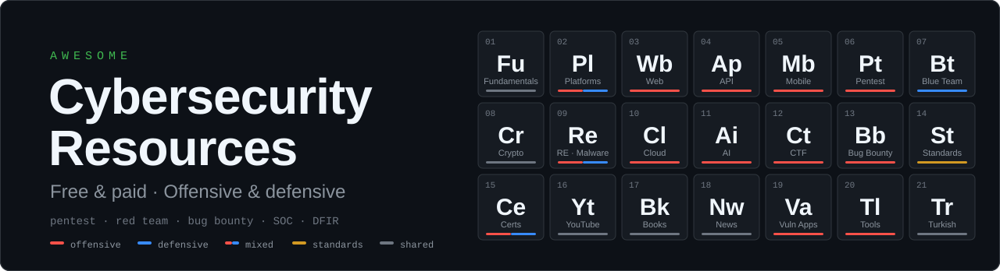

<h1 align="center"></h1>

A curated list of free and paid cybersecurity resources: ethical hacking and penetration testing labs, bug bounty, red team, blue team, SOC and DFIR training, CTF platforms, OWASP and MITRE ATT&amp;CK references, certifications, YouTube channels, books and tools, organized by domain and role. 
Filtered by offensive (pentest, red team, bug bounty) and defensive (SOC, DFIR, blue team) roles.

<b>Coverage:</b> TryHackMe · Hack The Box · PortSwigger Web Security Academy · OWASP MASTG and MASVS · HackTricks · MITRE ATT&amp;CK · CryptoHack · PentesterLab · Hackviser · HackingHub · Hacker101 · LiveOverflow · NetworkChuck · HackerSploit and more

Last reviewed: October 2026 · Prices and plans change often; check the official page before purchasing.

🇹🇷 <a href="OKUBENI.md">Türkçe sürüm (Turkish version)</a>

<a href="#roles">🧭 Browse by role</a> ·
<a href="#ethics">⚖️ Ethics</a> ·
<a href="#contributing">🤝 Contributing</a> ·
<a href="#license">📄 License</a>

---

## 🗂️ Contents

<table>
<tr><td align="center" width="33%"><a href="#fundamentals"><b>🎓 Fundamentals</b></a> 8 resources</td><td align="center" width="33%"><a href="#platforms"><b>🧪 Platforms</b></a> 16 resources</td><td align="center" width="33%"><a href="#web"><b>🌐 Web</b></a> 11 resources</td></tr>
<tr><td align="center" width="33%"><a href="#api"><b>🔌 API</b></a> 6 resources</td><td align="center" width="33%"><a href="#mobile"><b>📱 Mobile</b></a> 12 resources</td><td align="center" width="33%"><a href="#pentest"><b>🎯 Pentest &amp; Red Team</b></a> 13 resources</td></tr>
<tr><td align="center" width="33%"><a href="#blue-team"><b>🛡️ Blue Team</b></a> 16 resources</td><td align="center" width="33%"><a href="#crypto"><b>🔐 Crypto</b></a> 7 resources</td><td align="center" width="33%"><a href="#reverse"><b>🔬 RE &amp; Malware</b></a> 12 resources</td></tr>
<tr><td align="center" width="33%"><a href="#cloud"><b>☁️ Cloud</b></a> 8 resources</td><td align="center" width="33%"><a href="#ai"><b>🤖 AI</b></a> 7 resources</td><td align="center" width="33%"><a href="#ctf"><b>🚩 CTF</b></a> 8 resources</td></tr>
<tr><td align="center" width="33%"><a href="#bug-bounty"><b>💰 Bug Bounty</b></a> 10 resources</td><td align="center" width="33%"><a href="#standards"><b>📐 Standards</b></a> 14 resources</td><td align="center" width="33%"><a href="#certs"><b>🏅 Certifications</b></a> 20 resources</td></tr>
<tr><td align="center" width="33%"><a href="#youtube"><b>📺 YouTube</b></a> 19 resources</td><td align="center" width="33%"><a href="#books"><b>📚 Books</b></a> 12 resources</td><td align="center" width="33%"><a href="#news"><b>🎙️ News</b></a> 11 resources</td></tr>
<tr><td align="center" width="33%"><a href="#vuln-apps"><b>🐛 Vulnerable Apps</b></a> 11 resources</td><td align="center" width="33%"><a href="#tools"><b>🧰 Tools</b></a> 13 resources</td><td align="center" width="33%"><a href="#turkish"><b>🇹🇷 Turkish</b></a> 5 resources</td></tr>
</table>

---

## 📖 How to Read

| Badge | Meaning |
|---|---|
| 🟢 **Free** | All content is free to access (registration may be required) |
| 🟡 **Freemium** | A free tier exists; full access or certification is paid |
| 🔴 **Paid** | Purchase or subscription required |

In every section, resources are split into two groups: **🟢 Free** and **💳 Paid**. Freemium resources (free tier available) are listed in the Paid group and marked with a 🟡 badge.

**Level:** Beginner · Intermediate · Advanced. Content is in English unless stated otherwise.

**Side / Role:** Every row carries a badge showing which side and role the resource serves. On GitHub, use `Ctrl+F` and type `⚔️ Pentest` or `🛡️ SOC` to filter quickly.

| Badge | Side | Roles covered |
|---|---|---|
| ⚔️ | **Offensive** | Pentest, Web, Bug Bounty, Red Team, Exploit/RE, Mobile, API, Cloud, AI Red Team, CTF |
| 🛡️ | **Defensive** | SOC, DFIR, Detection, Malware Analysis, AppSec, Vuln Mgmt, Hardening, Threat Intel, Cloud Security |
| ⚔️🛡️ | **Mixed** | Content for both offense and defense (Purple Team approach) |
| 🏛️ | **GRC** | Governance, risk and compliance |
| 🧩 | **Shared** | Fundamentals, cryptography, standards, news and general resources |

---

## 🧭 Browse by Role

Pick a role and jump to the relevant sections.

| Role | What they do | Sections |
|---|---|---|
| ⚔️ Pentest | Authorized penetration testing of networks, systems and applications | [🧪 Platforms](#platforms) · [🎯 Pentest & Red Team](#pentest) · [🐛 Vulnerable Apps](#vuln-apps) |
| ⚔️ Web | Web application security testing | [🌐 Web](#web) · [🔌 API](#api) |
| ⚔️ Bug Bounty | Hunting vulnerabilities in bug bounty programs | [💰 Bug Bounty](#bug-bounty) · [🌐 Web](#web) |
| ⚔️ Red Team | Realistic adversary simulation, Active Directory | [🎯 Pentest & Red Team](#pentest) · [☁️ Cloud](#cloud) |
| ⚔️ Exploit / RE | Binary exploitation, reverse engineering | [🔬 RE & Malware](#reverse) · [🚩 CTF](#ctf) |
| ⚔️ Mobile / API / Cloud | Platform-focused offensive testing | [📱 Mobile](#mobile) · [🔌 API](#api) · [☁️ Cloud](#cloud) |
| ⚔️ AI Red Team | Attack testing of LLMs and AI systems | [🤖 AI](#ai) |
| 🛡️ SOC | Alert triage, monitoring, incident detection | [🛡️ Blue Team](#blue-team) |
| 🛡️ DFIR | Incident response and digital forensics | [🛡️ Blue Team](#blue-team) |
| 🛡️ Detection / Threat Hunting | Detection rules and threat hunting | [🛡️ Blue Team](#blue-team) · [📐 Standards](#standards) |
| 🛡️ Malware Analysis | Analyzing malicious software | [🔬 RE & Malware](#reverse) · [🛡️ Blue Team](#blue-team) |
| 🛡️ AppSec | Secure software development and code review | [🌐 Web](#web) · [📐 Standards](#standards) |
| 🏛️ GRC | Governance, risk and compliance | [📐 Standards](#standards) · [🏅 Certifications](#certs) |
| ⚔️🛡️ Purple Team | Running offense and defense together | [🎯 Pentest & Red Team](#pentest) · [🛡️ Blue Team](#blue-team) · [📐 Standards](#standards) |

---

## 🎓 Fundamentals

🟢 <b>6</b> free · 💳 <b>2</b> paid · <b>8</b> resources total

### 🟢 Free

| Resource | Side / Role | Type | Price | Level | Notes |
| --- | --- | --- | --- | --- | --- |
| [Professor Messer](https://www.professormesser.com) | 🧩 Fundamentals | Video | 🟢 | Beginner | Networking and security lessons aligned with the CompTIA curriculum |
| [OverTheWire: Bandit](https://overthewire.org/wargames/) | 🧩 Fundamentals | Wargame | 🟢 | Beginner | Linux command line and basic security skills |
| [Linux Journey](https://linuxjourney.com) | 🧩 Fundamentals | Web | 🟢 | Beginner | Linux fundamentals |
| [Hackviser CORE](https://hackviser.com/core) | 🧩 Fundamentals | Certification | 🟢 | Beginner | Free foundational cybersecurity certification |
| [CS50P (Harvard)](https://cs50.harvard.edu/python/) | 🧩 Fundamentals | Course | 🟢 | Beginner | Python basics; needed for automation and writing tools |
| [Automate the Boring Stuff with Python](https://automatetheboringstuff.com) | 🧩 Fundamentals | Book | 🟢 | Beginner | Practical automation with Python |

### 💳 Paid

| Resource | Side / Role | Type | Price | Level | Notes |
| --- | --- | --- | --- | --- | --- |
| [Cisco Networking Academy](https://www.netacad.com) | 🧩 Fundamentals | Course | 🟡 | Beginner | Introductory networking and cybersecurity courses |
| [Google Cybersecurity Certificate](https://www.coursera.org/professional-certificates/google-cybersecurity) | 🧩 Fundamentals | Course | 🔴 | Beginner | Requires a Coursera subscription; SOC-oriented introduction |

<a href="#top">↑ Back to top</a>

---

## 🧪 Training and Labs

🟢 <b>6</b> free · 💳 <b>10</b> paid · <b>16</b> resources total

### 🟢 Free

| Resource | Side / Role | Price | Level | Notes |
| --- | --- | --- | --- | --- |
| [PortSwigger Web Security Academy](https://portswigger.net/web-security) | ⚔️ Web | 🟢 | Beginner–Advanced | Web security from the makers of Burp Suite; labs for every vulnerability class |
| [Hacker101](https://www.hacker101.com) | ⚔️ Bug Bounty | 🟢 | Beginner | HackerOne's web security class and CTF |
| [pwn.college](https://pwn.college) | ⚔️ Exploit/RE | 🟢 | Intermediate–Advanced | Arizona State University; binary exploitation and systems security |
| [picoCTF](https://picoctf.org) | ⚔️ CTF | 🟢 | Beginner | Carnegie Mellon; education-focused CTF platform |
| [HackThisSite](https://www.hackthissite.org) | ⚔️ CTF | 🟢 | Beginner | Classic free hacking challenge site |
| [VulnHub](https://www.vulnhub.com) | ⚔️ Pentest | 🟢 | Intermediate | Archive of downloadable vulnerable VMs (new content has slowed down) |

### 💳 Paid

| Resource | Side / Role | Price | Level | Notes |
| --- | --- | --- | --- | --- |
| [TryHackMe](https://tryhackme.com) | ⚔️🛡️ Mixed | 🟡 | Beginner–Intermediate | Guided rooms and role-based paths; free users get limited daily VM time, full paths require Premium |
| [Hack The Box (Labs)](https://www.hackthebox.com) | ⚔️ Pentest | 🟡 | Intermediate–Advanced | Machines, challenges, Pro Labs and CTFs; free tier + VIP/VIP+ |
| [HTB Academy](https://academy.hackthebox.com) | ⚔️🛡️ Mixed | 🟡 | Beginner–Advanced | Modules and job-role paths; "cubes" model; student plan and exam vouchers are separate |
| [Hackviser](https://hackviser.com) | ⚔️🛡️ Mixed | 🟡 | Beginner–Intermediate | Warmups, Labs, Scenarios and an in-browser toolbox (HackerBox); CORE is free, CAPT, CWSE and CSOA are paid |
| [HackingHub](https://www.hackinghub.io) | ⚔️ Bug Bounty | 🟡 | Intermediate | Bug bounty labs based on real vulnerabilities; free lab library + premium |
| [PentesterLab](https://pentesterlab.com) | ⚔️ Web | 🟡 | Intermediate | Free exercises + PRO subscription; web vulnerabilities and code review |
| [Root-Me](https://www.root-me.org) | ⚔️ CTF | 🟡 | Beginner–Advanced | Large challenge archive, community-driven |
| [TCM Security Academy](https://academy.tcm-sec.com) | ⚔️ Pentest | 🟡 | Beginner–Intermediate | Practical Ethical Hacking and the PNPT certification |
| [OffSec](https://www.offsec.com) | ⚔️ Pentest | 🔴 | Intermediate–Advanced | PEN-200 (OSCP), Proving Grounds and advanced courses |
| [INE](https://ine.com) | ⚔️ Pentest | 🟡 | Beginner–Advanced | Certification paths including eJPT and eCPPT |

<a href="#top">↑ Back to top</a>

---

## 🌐 Web Security

🟢 <b>10</b> free · 💳 <b>1</b> paid · <b>11</b> resources total

### 🟢 Free

| Resource | Side / Role | Type | Price | Level | Notes |
| --- | --- | --- | --- | --- | --- |
| [PortSwigger Web Security Academy](https://portswigger.net/web-security) | ⚔️ Web | Lab | 🟢 | Beginner–Advanced | SQLi, XSS, SSRF, deserialization, request smuggling, LLM attacks and more |
| [OWASP Web Security Testing Guide](https://owasp.org/www-project-web-security-testing-guide/) | ⚔️ Web | Guide | 🟢 | Intermediate | Web testing methodology |
| [OWASP Top 10](https://owasp.org/www-project-top-ten/) | 🧩 AppSec | Reference | 🟢 | Beginner | List of the most common web risks |
| [OWASP Cheat Sheet Series](https://cheatsheetseries.owasp.org) | 🛡️ AppSec | Reference | 🟢 | All | Defense-focused practical summaries |
| [OWASP ASVS](https://owasp.org/www-project-application-security-verification-standard/) | 🛡️ AppSec | Standard | 🟢 | Intermediate | Application security verification requirements |
| [The XSS Rat](https://www.youtube.com/@TheXSSrat) | ⚔️ Web | YouTube | 🟢 | Beginner–Intermediate | Bug bounty and web vulnerability explainers |
| [Rana Khalil](https://www.youtube.com/@RanaKhalil101) | ⚔️ Web | YouTube | 🟢 | Intermediate | Web Security Academy lab walkthroughs |
| [PwnFunction](https://www.youtube.com/@PwnFunction) | ⚔️ Web | YouTube | 🟢 | Beginner | Animated explanations of web vulnerabilities |
| [PayloadsAllTheThings](https://github.com/swisskyrepo/PayloadsAllTheThings) | ⚔️ Web | Reference | 🟢 | Intermediate | Payload and bypass collection per vulnerability class |
| [HackTricks – Pentesting Web](https://book.hacktricks.wiki) | ⚔️ Pentest | Wiki | 🟢 | Intermediate–Advanced | Collection of techniques and methodology |

### 💳 Paid

| Resource | Side / Role | Type | Price | Level | Notes |
| --- | --- | --- | --- | --- | --- |
| [Burp Suite](https://portswigger.net/burp) | ⚔️ Web | Tool | 🟡 | All | Community is free, Professional is paid |

<a href="#top">↑ Back to top</a>

---

## 🔌 API Security

🟢 <b>6</b> free · <b>6</b> resources total

### 🟢 Free

| Resource | Side / Role | Type | Price | Level | Notes |
| --- | --- | --- | --- | --- | --- |
| [OWASP API Security Top 10](https://owasp.org/API-Security/) | 🧩 AppSec | Reference | 🟢 | Beginner | Risk list specific to APIs |
| [Damn Vulnerable RESTaurant](https://github.com/theowni/Damn-Vulnerable-RESTaurant-API-Game) | ⚔️🛡️ Mixed | Lab | 🟢 | Beginner–Intermediate | Python FastAPI + PostgreSQL; attack, detect and fix. Runs with Docker or GitHub Codespaces (GPL-3.0) |
| [OWASP crAPI](https://github.com/OWASP/crAPI) | ⚔️ API | Lab | 🟢 | Intermediate | Realistic microservice-based vulnerable API |
| [VAmPI](https://github.com/erev0s/VAmPI) | ⚔️ API | Lab | 🟢 | Beginner | Vulnerable REST API |
| [APIsec University](https://www.apisecuniversity.com) | ⚔️ API | Course | 🟢 | Beginner–Intermediate | Free API security courses |
| [PortSwigger: API testing](https://portswigger.net/web-security/api-testing) | ⚔️ API | Lab | 🟢 | Intermediate | API testing techniques |

<a href="#top">↑ Back to top</a>

---

## 📱 Mobile Security

🟢 <b>11</b> free · 💳 <b>1</b> paid · <b>12</b> resources total

> OWASP MASTG completed its restructuring and was released as **v2.0.0** in June 2026; MASVS, MASWE and MASTG now work together as linked projects.

### 🟢 Free

| Resource | Side / Role | Type | Price | Level | Notes |
| --- | --- | --- | --- | --- | --- |
| [OWASP MASVS](https://mas.owasp.org/MASVS/) | 🧩 Mobile | Standard | 🟢 | Intermediate | Mobile app security verification standard (v2.0) |
| [OWASP MASTG](https://mas.owasp.org/MASTG/) | ⚔️ Mobile | Guide | 🟢 | Intermediate–Advanced | Android/iOS testing procedures, techniques and tools |
| [OWASP MASWE](https://mas.owasp.org/MASWE/) | 🧩 Mobile | Reference | 🟢 | Intermediate | Mobile weakness enumeration |
| [MAS Checklist](https://mas.owasp.org/checklists/) | 🧩 Mobile | Checklist | 🟢 | Intermediate | MASVS checklist |
| [MAS Crackmes (UnCrackable Apps)](https://mas.owasp.org/crackmes/) | ⚔️ Mobile | Lab | 🟢 | Intermediate–Advanced | Reverse engineering and resilience practice |
| [DVIA-v2](https://github.com/prateek147/DVIA-v2) | ⚔️ Mobile | Lab | 🟢 | Beginner | Vulnerable iOS app |
| [InsecureBankv2](https://github.com/dineshshetty/Android-InsecureBankv2) | ⚔️ Mobile | Lab | 🟢 | Beginner | Vulnerable Android banking app |
| [Frida](https://frida.re) | ⚔️ Mobile | Tool | 🟢 | Intermediate–Advanced | Dynamic instrumentation |
| [objection](https://github.com/sensepost/objection) | ⚔️ Mobile | Tool | 🟢 | Intermediate | Frida-based runtime inspection |
| [MobSF](https://github.com/MobSF/Mobile-Security-Framework-MobSF) | ⚔️ Mobile | Tool | 🟢 | Beginner–Intermediate | Static and dynamic mobile analysis |
| [jadx](https://github.com/skylot/jadx) | ⚔️ Mobile | Tool | 🟢 | Intermediate | Android decompiler |

### 💳 Paid

| Resource | Side / Role | Type | Price | Level | Notes |
| --- | --- | --- | --- | --- | --- |
| [HackingHub](https://www.hackinghub.io) | ⚔️ Mobile | Platform | 🟡 | Intermediate | Android and iOS labs |

<a href="#top">↑ Back to top</a>

---

## 🎯 Penetration Testing and Red Teaming

🟢 <b>11</b> free · 💳 <b>2</b> paid · <b>13</b> resources total

### 🟢 Free

| Resource | Side / Role | Type | Price | Level | Notes |
| --- | --- | --- | --- | --- | --- |
| [HackTricks](https://book.hacktricks.wiki) | ⚔️ Pentest | Wiki | 🟢 | Intermediate–Advanced | Encyclopedia of pentesting techniques |
| [The Hacker Recipes](https://www.thehacker.recipes) | ⚔️ Red Team | Wiki | 🟢 | Intermediate–Advanced | Active Directory and network attack techniques |
| [ired.team](https://www.ired.team) | ⚔️ Red Team | Wiki | 🟢 | Advanced | Red team notes |
| [ADSecurity.org](https://adsecurity.org) | ⚔️ Red Team | Blog | 🟢 | Advanced | Active Directory security |
| [MITRE ATT&CK](https://attack.mitre.org) | 🧩 Threat Model | Reference | 🟢 | All | Knowledge base of adversary tactics and techniques |
| [IppSec](https://www.youtube.com/@ippsec) | ⚔️ Pentest | YouTube | 🟢 | Intermediate–Advanced | HTB machine walkthroughs and methodology |
| [PTES](http://www.pentest-standard.org) | ⚔️ Pentest | Standard | 🟢 | Intermediate | Penetration Testing Execution Standard |
| [GTFOBins](https://gtfobins.github.io) | ⚔️ Pentest | Reference | 🟢 | Intermediate | Techniques for abusing Unix binaries |
| [LOLBAS](https://lolbas-project.github.io) | ⚔️ Pentest | Reference | 🟢 | Intermediate | Windows "living off the land" binaries |
| [BloodHound](https://github.com/SpecterOps/BloodHound) | ⚔️ Red Team | Tool | 🟢 | Intermediate–Advanced | Active Directory attack path analysis |
| [Impacket](https://github.com/fortra/impacket) | ⚔️ Red Team | Tool | 🟢 | Intermediate–Advanced | Python library for network protocols |

### 💳 Paid

| Resource | Side / Role | Type | Price | Level | Notes |
| --- | --- | --- | --- | --- | --- |
| [HackTricks Training](https://training.hacktricks.xyz) | ⚔️ Red Team | Training | 🔴 | Advanced | Cloud and Linux focused red team training |
| [HTB Pro Labs](https://www.hackthebox.com) | ⚔️ Red Team | Lab | 🔴 | Advanced | Enterprise network simulations |

<a href="#top">↑ Back to top</a>

---

## 🛡️ Blue Team, SOC and DFIR

🟢 <b>7</b> free · 💳 <b>9</b> paid · <b>16</b> resources total

> LetsDefend was acquired by Hack The Box in September 2025; its content is being integrated into the HTB ecosystem.

### 🟢 Free

| Resource | Side / Role | Type | Price | Level | Notes |
| --- | --- | --- | --- | --- | --- |
| [MITRE D3FEND](https://d3fend.mitre.org) | 🛡️ Detection | Reference | 🟢 | Intermediate | Knowledge graph of defensive techniques |
| [Sigma](https://github.com/SigmaHQ/sigma) | 🛡️ Detection | Tool | 🟢 | Intermediate | SIEM-agnostic detection rule format |
| [Atomic Red Team](https://github.com/redcanaryco/atomic-red-team) | 🛡️ Detection | Tool | 🟢 | Intermediate | Detection tests mapped to ATT&CK |
| [Malware-Traffic-Analysis.net](https://www.malware-traffic-analysis.net) | 🛡️ DFIR | Archive | 🟢 | Intermediate | Real infection analyses and exercises with PCAPs |
| [SANS Reading Room](https://www.sans.org/white-papers/) | 🛡️ DFIR | Article | 🟢 | Intermediate–Advanced | Free technical white papers |
| [13Cubed](https://www.youtube.com/@13Cubed) | 🛡️ DFIR | YouTube | 🟢 | Intermediate | DFIR and incident response |
| [Splunk](https://www.splunk.com) / [Elastic](https://www.elastic.co) free training | 🛡️ SOC | Training | 🟢 | Beginner–Intermediate | For building SIEM and log analysis skills |

### 💳 Paid

| Resource | Side / Role | Type | Price | Level | Notes |
| --- | --- | --- | --- | --- | --- |
| [TryHackMe SOC paths](https://tryhackme.com) | 🛡️ SOC | Platform | 🟡 | Beginner–Intermediate | SOC Level 1, DFIR and threat hunting paths |
| [LetsDefend](https://letsdefend.io) | 🛡️ SOC | Platform | 🟡 | Beginner–Intermediate | Alert triage and SOC workflow simulation |
| [CyberDefenders](https://cyberdefenders.org) | 🛡️ DFIR | Platform | 🟡 | Intermediate–Advanced | Digital forensics (network, disk, memory) and threat hunting; CCDL certification path |
| [Blue Team Labs Online](https://blueteamlabs.online) | 🛡️ DFIR | Platform | 🟡 | Intermediate | Log analysis, memory forensics and threat intelligence challenges |
| [Security Blue Team](https://securityblue.team) | 🛡️ SOC | Training | 🔴 | Beginner–Intermediate | BTL1 / BTL2 certification path |
| [HTB Academy – Defensive paths](https://academy.hackthebox.com) | 🛡️ SOC | Platform | 🟡 | Intermediate | SOC analyst and DFIR modules, CDSA certification |
| [Hackviser CSOA](https://hackviser.com) | 🛡️ SOC | Certification | 🔴 | Intermediate | SOC analyst certification |
| [Security Onion](https://securityonionsolutions.com) | 🛡️ SOC | Tool | 🟡 | Intermediate | Open-source network security monitoring and threat hunting |
| [SANS Institute](https://www.sans.org) | 🧩 General | Training | 🔴 | Intermediate–Advanced | GIAC certifications; an industry standard but expensive |

<a href="#top">↑ Back to top</a>

---

## 🔐 Cryptography

🟢 <b>4</b> free · 💳 <b>3</b> paid · <b>7</b> resources total

### 🟢 Free

| Resource | Side / Role | Type | Price | Level | Notes |
| --- | --- | --- | --- | --- | --- |
| [CryptoHack](https://cryptohack.org) | 🧩 Crypto | Platform | 🟢 | Beginner–Advanced | Interactive, gamified crypto challenges |
| [Cryptopals](https://cryptopals.com) | 🧩 Crypto | Exercise | 🟢 | Intermediate–Advanced | Learn by implementing real cryptographic attacks |
| [Crypto 101](https://www.crypto101.io) | 🧩 Crypto | Book | 🟢 | Beginner | Free introductory book |
| [Practical Cryptography for Developers](https://cryptobook.nakov.com) | 🧩 Crypto | Book | 🟢 | Intermediate | Practical cryptography for developers |

### 💳 Paid

| Resource | Side / Role | Type | Price | Level | Notes |
| --- | --- | --- | --- | --- | --- |
| [Cryptography I (Dan Boneh)](https://www.coursera.org/learn/crypto) | 🧩 Crypto | Course | 🟡 | Intermediate | Stanford; on Coursera |
| Serious Cryptography (Aumasson) | 🧩 Crypto | Book | 🔴 | Intermediate | Hands-on introduction to modern cryptography |
| Real-World Cryptography (David Wong) | 🧩 Crypto | Book | 🔴 | Intermediate | Cryptography in real-world systems |

<a href="#top">↑ Back to top</a>

---

## 🔬 Reverse Engineering, Malware Analysis and Exploit Development

🟢 <b>11</b> free · 💳 <b>1</b> paid · <b>12</b> resources total

### 🟢 Free

| Resource | Side / Role | Type | Price | Level | Notes |
| --- | --- | --- | --- | --- | --- |
| [LiveOverflow](https://www.youtube.com/@LiveOverflow) | ⚔️ Exploit/RE | YouTube | 🟢 | Beginner–Advanced | Binary exploitation, reverse engineering, CTF and web |
| [pwn.college](https://pwn.college) | ⚔️ Exploit/RE | Platform | 🟢 | Intermediate–Advanced | Systematic exploit development curriculum |
| [Nightmare](https://guyinatuxedo.github.io) | ⚔️ Exploit/RE | Course | 🟢 | Intermediate | CTF-oriented binary exploitation |
| [ROP Emporium](https://ropemporium.com) | ⚔️ Exploit/RE | Exercise | 🟢 | Intermediate–Advanced | ROP chain exercises |
| [Exploit Education](https://exploit.education) | ⚔️ Exploit/RE | Lab | 🟢 | Intermediate | Vulnerable VMs for exploit development |
| [Malware Unicorn](https://malwareunicorn.org) | 🛡️ Malware Analysis | Workshop | 🟢 | Intermediate | Reverse engineering and malware analysis workshops |
| [OALabs](https://www.youtube.com/@OALABS) | 🛡️ Malware Analysis | YouTube | 🟢 | Intermediate–Advanced | Malware analysis |
| [OpenSecurityTraining2](https://ost2.fyi) | ⚔️ Exploit/RE | Course | 🟢 | Intermediate–Advanced | Free advanced security courses |
| [Azeria Labs](https://azeria-labs.com) | ⚔️ Exploit/RE | Training | 🟢 | Intermediate | ARM assembly and exploitation |
| [Crackmes.one](https://crackmes.one) | ⚔️ Exploit/RE | Exercise | 🟢 | Beginner–Advanced | Community crackme archive |
| [Ghidra](https://ghidra-sre.org) | 🧩 Reverse Eng. | Tool | 🟢 | Intermediate | NSA's open-source reverse engineering tool |

### 💳 Paid

| Resource | Side / Role | Type | Price | Level | Notes |
| --- | --- | --- | --- | --- | --- |
| [ANY.RUN](https://any.run) | 🛡️ Malware Analysis | Sandbox | 🟡 | Intermediate | Interactive malware sandbox |

<a href="#top">↑ Back to top</a>

---

## ☁️ Cloud and Container Security

🟢 <b>5</b> free · 💳 <b>3</b> paid · <b>8</b> resources total

### 🟢 Free

| Resource | Side / Role | Type | Price | Level | Notes |
| --- | --- | --- | --- | --- | --- |
| [flAWS](http://flaws.cloud) / [flAWS2](http://flaws2.cloud) | ⚔️ Cloud | Lab | 🟢 | Beginner–Intermediate | AWS misconfiguration challenges |
| [CloudGoat](https://github.com/RhinoSecurityLabs/cloudgoat) | ⚔️ Cloud | Lab | 🟢 | Intermediate | Deployment of a vulnerable AWS environment |
| [Hacking the Cloud](https://hackingthe.cloud) | ⚔️ Cloud | Wiki | 🟢 | Intermediate–Advanced | Encyclopedia of cloud attack techniques |
| [HackTricks Cloud](https://cloud.hacktricks.wiki) | ⚔️ Cloud | Wiki | 🟢 | Intermediate–Advanced | AWS, GCP, Azure and CI/CD pentesting techniques |
| [Kubernetes Goat](https://github.com/madhuakula/kubernetes-goat) | ⚔️ Cloud | Lab | 🟢 | Intermediate | Vulnerable Kubernetes environment |

### 💳 Paid

| Resource | Side / Role | Type | Price | Level | Notes |
| --- | --- | --- | --- | --- | --- |
| [HackTricks Training (ARTE, GRTE, AzRTE)](https://training.hacktricks.xyz) | ⚔️ Cloud | Training | 🔴 | Advanced | Red team specialist training for AWS, GCP and Azure |
| [Pwned Labs](https://pwnedlabs.io) | ⚔️ Cloud | Platform | 🟡 | Intermediate–Advanced | Realistic cloud-focused labs |
| [AWS Skill Builder](https://skillbuilder.aws) | 🛡️ Cloud Security | Training | 🟡 | Beginner–Intermediate | Free foundational security content; some courses are paid |

<a href="#top">↑ Back to top</a>

---

## 🤖 AI and LLM Security

🟢 <b>6</b> free · 💳 <b>1</b> paid · <b>7</b> resources total

### 🟢 Free

| Resource | Side / Role | Type | Price | Level | Notes |
| --- | --- | --- | --- | --- | --- |
| [OWASP GenAI Security Project](https://genai.owasp.org) | 🧩 AI Security | Reference | 🟢 | Beginner–Intermediate | LLM Top 10 (2026 edition published), Agentic AI Top 10 and GenAI Red Teaming Guide |
| [GenAI Red Team Lab](https://github.com/GenAI-Security-Project/GenAI-Red-Team-Lab) | ⚔️ AI Red Team | Lab | 🟢 | Intermediate | OWASP's LLM red team sandbox and examples |
| [MITRE ATLAS](https://atlas.mitre.org) | 🧩 AI Security | Reference | 🟢 | Intermediate | Adversary tactics against AI systems |
| [PortSwigger: LLM attacks](https://portswigger.net/web-security/llm-attacks) | ⚔️ AI Red Team | Lab | 🟢 | Intermediate | Prompt injection and LLM API exploitation |
| [Gandalf (Lakera)](https://gandalf.lakera.ai) | ⚔️ AI Red Team | Game | 🟢 | Beginner | Prompt injection practice |
| [awesome-ai-security](https://github.com/ottosulin/awesome-ai-security) | 🧩 AI Security | List | 🟢 | All | Collection of frameworks, tools and learning resources |

### 💳 Paid

| Resource | Side / Role | Type | Price | Level | Notes |
| --- | --- | --- | --- | --- | --- |
| [Crucible (Dreadnode)](https://crucible.dreadnode.io) | ⚔️ AI Red Team | Platform | 🟡 | Intermediate | AI/ML security challenges |

<a href="#top">↑ Back to top</a>

---

## 🚩 CTF Platforms and Competitions

🟢 <b>6</b> free · 💳 <b>2</b> paid · <b>8</b> resources total

### 🟢 Free

| Resource | Side / Role | Price | Level | Notes |
| --- | --- | --- | --- | --- |
| [CTFtime](https://ctftime.org) | ⚔️ CTF | 🟢 | All | Global CTF calendar and team rankings |
| [picoCTF](https://picoctf.org) | ⚔️ CTF | 🟢 | Beginner | Year-round practice archive |
| [OverTheWire](https://overthewire.org/wargames/) | ⚔️ CTF | 🟢 | Beginner–Advanced | Wargame series (Bandit, Leviathan, Natas, etc.) |
| [CryptoHack](https://cryptohack.org) | ⚔️ CTF | 🟢 | Beginner–Advanced | Crypto-focused |
| [Hacker101 CTF](https://www.hacker101.com) | ⚔️ CTF | 🟢 | Beginner | Earn enough points to get private bug bounty program invites |
| [TEKNOFEST Cybersecurity competitions](https://www.teknofest.org) | ⚔️ CTF | 🟢 | Intermediate | National competitions held in Turkey; announcements via official TEKNOFEST channels |

### 💳 Paid

| Resource | Side / Role | Price | Level | Notes |
| --- | --- | --- | --- | --- |
| [Root-Me](https://www.root-me.org) | ⚔️ CTF | 🟡 | Beginner–Advanced | Multi-category challenges |
| [HTB CTFs](https://ctf.hackthebox.com) | ⚔️ CTF | 🟡 | Intermediate–Advanced | Team and university CTFs |

<a href="#top">↑ Back to top</a>

---

## 💰 Bug Bounty Hunting

🟢 <b>10</b> free · <b>10</b> resources total

### 🟢 Free

| Resource | Side / Role | Type | Price | Level | Notes |
| --- | --- | --- | --- | --- | --- |
| [HackerOne](https://www.hackerone.com) | ⚔️ Bug Bounty | Platform | 🟢 | All | Bug bounty platform; [Hacktivity](https://hackerone.com/hacktivity) has public reports |
| [Bugcrowd](https://www.bugcrowd.com) | ⚔️ Bug Bounty | Platform | 🟢 | All | Bug bounty and VDP programs |
| [Intigriti](https://www.intigriti.com) | ⚔️ Bug Bounty | Platform | 🟢 | All | Europe-based bug bounty platform |
| [YesWeHack](https://www.yeswehack.com) | ⚔️ Bug Bounty | Platform | 🟢 | All | Europe-based bug bounty platform |
| [Pentester Land](https://pentester.land) | ⚔️ Bug Bounty | Archive | 🟢 | Intermediate | Bug bounty writeups and resource list |
| [Critical Thinking – Bug Bounty Podcast](https://www.criticalthinkingpodcast.io) | ⚔️ Bug Bounty | Podcast | 🟢 | Intermediate–Advanced | Technical bug bounty conversations |
| [NahamSec](https://www.youtube.com/@NahamSec) | ⚔️ Bug Bounty | YouTube | 🟢 | Beginner–Intermediate | Bug bounty and recon |
| [STÖK](https://www.youtube.com/@STOKfredrik) | ⚔️ Bug Bounty | YouTube | 🟢 | Intermediate | Bug bounty and tool reviews |
| [InsiderPhD](https://www.youtube.com/@InsiderPhD) | ⚔️ Bug Bounty | YouTube | 🟢 | Beginner | Bug bounty explained for beginners |
| [Bug Bounty Reports Explained](https://www.youtube.com/@BugBountyReportsExplained) | ⚔️ Bug Bounty | YouTube | 🟢 | Intermediate | Analysis of real reports |

<a href="#top">↑ Back to top</a>

---

## 📐 Standards and Frameworks

🟢 <b>12</b> free · 💳 <b>2</b> paid · <b>14</b> resources total

### 🟢 Free

| Resource | Side / Role | Domain | Price | Notes |
| --- | --- | --- | --- | --- |
| [MITRE ATT&CK](https://attack.mitre.org) | 🧩 Threat Model | Threat modeling | 🟢 | Adversary tactics and techniques |
| [MITRE D3FEND](https://d3fend.mitre.org) | 🛡️ Detection | Defense | 🟢 | Knowledge graph of defensive techniques |
| [MITRE ATLAS](https://atlas.mitre.org) | 🧩 AI Security | AI security | 🟢 | Attacks on AI systems |
| [MITRE CAPEC](https://capec.mitre.org) | 🧩 Threat Model | Attack patterns | 🟢 | Catalog of common attack patterns |
| [CWE](https://cwe.mitre.org) | 🧩 AppSec | Weaknesses | 🟢 | Software weakness enumeration |
| [CVE](https://www.cve.org) / [NVD](https://nvd.nist.gov) | 🛡️ Vuln Mgmt | Vulnerabilities | 🟢 | Vulnerability identifiers and database |
| [CISA KEV](https://www.cisa.gov/known-exploited-vulnerabilities-catalog) | 🛡️ Vuln Mgmt | Vulnerabilities | 🟢 | Catalog of actively exploited vulnerabilities |
| [EPSS](https://www.first.org/epss/) | 🛡️ Vuln Mgmt | Risk prioritization | 🟢 | Exploit probability score |
| [NIST Cybersecurity Framework](https://www.nist.gov/cyberframework) | 🏛️ GRC | Governance | 🟢 | CSF 2.0 |
| [OWASP SAMM](https://owaspsamm.org) | 🛡️ AppSec | Secure software | 🟢 | Software assurance maturity model |
| [OWASP MASVS](https://mas.owasp.org/MASVS/) | 🧩 Mobile | Mobile | 🟢 | Mobile security verification standard |
| [OWASP ASVS](https://owasp.org/www-project-application-security-verification-standard/) | 🛡️ AppSec | Web | 🟢 | Application security verification standard |

### 💳 Paid

| Resource | Side / Role | Domain | Price | Notes |
| --- | --- | --- | --- | --- |
| [CIS Controls / Benchmarks](https://www.cisecurity.org) | 🛡️ Hardening | Hardening | 🟡 | Free PDFs; extra tools require membership |
| ISO/IEC 27001 | 🏛️ GRC | Management system | 🔴 | Standard text is paid |

<a href="#top">↑ Back to top</a>

---

## 🏅 Certifications

🟢 <b>1</b> free · 💳 <b>19</b> paid · <b>20</b> resources total

> Exam fees and bundles vary; verify on the official page. Hands-on (practical) exams are generally valued more by employers.

### 🟢 Free

| Certification | Side / Role | Issuer | Focus | Price | Level |
| --- | --- | --- | --- | --- | --- |
| CORE | 🧩 Fundamentals | Hackviser | Core cybersecurity | 🟢 | Beginner |

### 💳 Paid

| Certification | Side / Role | Issuer | Focus | Price | Level |
| --- | --- | --- | --- | --- | --- |
| CAPT / CWSE / CSOA | ⚔️🛡️ Mixed | Hackviser | Pentest, web, SOC | 🔴 | Intermediate |
| PT1 / SAL1 | ⚔️🛡️ Mixed | TryHackMe | Pentest, SOC | 🔴 | Beginner–Intermediate |
| eJPT / eCPPT | ⚔️ Pentest | INE | Junior pentest | 🔴 | Beginner–Intermediate |
| PNPT | ⚔️ Pentest | TCM Security | Hands-on pentest + reporting | 🔴 | Intermediate |
| CPTS | ⚔️ Pentest | Hack The Box | Pentest | 🔴 | Intermediate–Advanced |
| CBBH (CWES) | ⚔️ Web | Hack The Box | Web | 🔴 | Intermediate |
| CDSA | 🛡️ SOC | Hack The Box | SOC / defense | 🔴 | Intermediate |
| CWEE | ⚔️ Web | Hack The Box | Advanced web exploitation | 🔴 | Advanced |
| BSCP | ⚔️ Web | PortSwigger | Web security with Burp | 🔴 | Intermediate |
| BTL1 / BTL2 | 🛡️ SOC | Security Blue Team | SOC / IR | 🔴 | Beginner–Intermediate |
| CCDL1 / CCDL2 | 🛡️ DFIR | CyberDefenders | Blue team | 🔴 | Intermediate |
| OSCP / OSCP+ | ⚔️ Pentest | OffSec | Pentest | 🔴 | Intermediate–Advanced |
| OSEP / OSWE / OSED | ⚔️ Red Team | OffSec | Red team / web / exploit dev | 🔴 | Advanced |
| CRTO | ⚔️ Red Team | Zero-Point Security | Red team operations | 🔴 | Intermediate–Advanced |
| GPEN / GCIH / GCFA vb. | ⚔️🛡️ Mixed | SANS / GIAC | Pentest, IR, digital forensics | 🔴 | Intermediate–Advanced |
| Security+ / Network+ / PenTest+ | 🧩 Fundamentals | CompTIA | General fundamentals | 🔴 | Beginner |
| CISSP | 🏛️ GRC | ISC2 | Management and architecture | 🔴 | Advanced |
| CISM / CISA | 🏛️ GRC | ISACA | Governance / audit | 🔴 | Advanced |
| CEH | ⚔️ Pentest | EC-Council | General ethical hacking | 🔴 | Beginner–Intermediate (common in tender and HR requirements) |

<a href="#top">↑ Back to top</a>

---

## 📺 YouTube Channels

🟢 <b>19</b> free · <b>19</b> resources total

### 🟢 Free

| Channel | Side / Role | Focus | Level |
| --- | --- | --- | --- |
| [NetworkChuck](https://www.youtube.com/@NetworkChuck) | 🧩 Fundamentals | Intro to networking, Linux and ethical hacking | Beginner |
| [HackerSploit](https://www.youtube.com/@HackerSploit) | ⚔️ Pentest | Pentest tools, methodology, Linux | Beginner–Intermediate |
| [The XSS Rat](https://www.youtube.com/@TheXSSrat) | ⚔️ Web | Web vulnerabilities and bug bounty | Beginner–Intermediate |
| [LiveOverflow](https://www.youtube.com/@LiveOverflow) | ⚔️ Exploit/RE | Binary exploitation, reverse engineering, web | Intermediate–Advanced |
| [IppSec](https://www.youtube.com/@ippsec) | ⚔️ Pentest | HTB machine walkthroughs | Intermediate–Advanced |
| [John Hammond](https://www.youtube.com/@_JohnHammond) | ⚔️🛡️ Mixed | CTF, malware, cyber news | Beginner–Intermediate |
| [David Bombal](https://www.youtube.com/@davidbombal) | 🧩 Fundamentals | Networking, cybersecurity, interviews | Beginner–Intermediate |
| [The Cyber Mentor (TCM)](https://www.youtube.com/@TCMSecurityAcademy) | ⚔️ Pentest | Pentest, AD, career | Beginner–Intermediate |
| [Black Hills Information Security](https://www.youtube.com/@BlackHillsInformationSecurity) | ⚔️🛡️ Mixed | Pentest, SOC, webcasts | Intermediate |
| [13Cubed](https://www.youtube.com/@13Cubed) | 🛡️ DFIR | DFIR | Intermediate |
| [OALabs](https://www.youtube.com/@OALABS) | 🛡️ Malware Analysis | Malware analysis | Intermediate–Advanced |
| [Professor Messer](https://www.youtube.com/@professormesser) | 🧩 Fundamentals | CompTIA fundamentals | Beginner |
| [NahamSec](https://www.youtube.com/@NahamSec) | ⚔️ Bug Bounty | Bug bounty | Beginner–Intermediate |
| [STÖK](https://www.youtube.com/@STOKfredrik) | ⚔️ Bug Bounty | Bug bounty | Intermediate |
| [InsiderPhD](https://www.youtube.com/@InsiderPhD) | ⚔️ Bug Bounty | Bug bounty for beginners | Beginner |
| [Bug Bounty Reports Explained](https://www.youtube.com/@BugBountyReportsExplained) | ⚔️ Bug Bounty | Report analyses | Intermediate |
| [PwnFunction](https://www.youtube.com/@PwnFunction) | ⚔️ Web | Animated vulnerability explainers | Beginner |
| [Rana Khalil](https://www.youtube.com/@RanaKhalil101) | ⚔️ Web | Web Security Academy walkthroughs | Intermediate |
| [Computerphile](https://www.youtube.com/@Computerphile) | 🧩 Fundamentals | Computer science and security concepts | Beginner |

<a href="#top">↑ Back to top</a>

---

## 📚 Books

🟢 <b>2</b> free · 💳 <b>10</b> paid · <b>12</b> resources total

### 🟢 Free

| Book | Side / Role | Domain | Price | Level |
| --- | --- | --- | --- | --- |
| Security Engineering (Ross Anderson) | 🧩 General | System security | 🟢 | Intermediate–Advanced (the author publishes it free online) |
| [Crypto 101](https://www.crypto101.io) | 🧩 Crypto | Cryptography | 🟢 | Beginner |

### 💳 Paid

| Book | Side / Role | Domain | Price | Level |
| --- | --- | --- | --- | --- |
| Hacking: The Art of Exploitation (Jon Erickson) | ⚔️ Exploit/RE | Exploit, C, assembly | 🔴 | Intermediate |
| The Web Application Hacker's Handbook (Stuttard, Pinto) | ⚔️ Web | Web (classic, partly dated) | 🔴 | Intermediate |
| Bug Bounty Bootcamp (Vickie Li) | ⚔️ Bug Bounty | Bug bounty | 🔴 | Beginner–Intermediate |
| Real-World Bug Hunting (Peter Yaworski) | ⚔️ Bug Bounty | Bug bounty | 🔴 | Beginner |
| The Tangled Web (Michal Zalewski) | ⚔️ Web | Browser security | 🔴 | Intermediate |
| Practical Malware Analysis (Sikorski, Honig) | 🛡️ Malware Analysis | Malware analysis | 🔴 | Intermediate |
| Practical Binary Analysis (Dennis Andriesse) | ⚔️🛡️ Mixed | Binary analysis | 🔴 | Intermediate–Advanced |
| The Hacker Playbook 3 (Peter Kim) | ⚔️ Red Team | Pentest / red team | 🔴 | Intermediate |
| Red Team Field Manual (RTFM) | ⚔️ Red Team | Red team command reference | 🔴 | Intermediate |
| Black Hat Python (Justin Seitz) | ⚔️ Pentest | Security tools with Python | 🔴 | Intermediate |

<a href="#top">↑ Back to top</a>

---

## 🎙️ Podcasts, News and Newsletters

🟢 <b>12</b> free · <b>12</b> resources total

### 🟢 Free

| Resource | Side / Role | Type | Price | Notes |
| --- | --- | --- | --- | --- |
| [Darknet Diaries](https://darknetdiaries.com) | 🧩 News | Podcast | 🟢 | True stories of real cyber incidents |
| [Risky Business](https://risky.biz) | 🧩 News | Podcast | 🟢 | Weekly industry news |
| [Critical Thinking](https://www.criticalthinkingpodcast.io) | ⚔️ Bug Bounty | Podcast | 🟢 | Bug bounty and research |
| [tl;dr sec](https://tldrsec.com) | 🧩 News | Newsletter | 🟢 | Weekly digest of security research |
| [The Hacker News](https://thehackernews.com) | 🧩 News | News | 🟢 | Cybersecurity news |
| [BleepingComputer](https://www.bleepingcomputer.com) | 🧩 News | News | 🟢 | Ransomware, vulnerability and incident news |
| [Krebs on Security](https://krebsonsecurity.com) | 🧩 News | Blog | 🟢 | Investigative journalism |
| [Schneier on Security](https://www.schneier.com) | 🧩 News | Blog | 🟢 | Analysis of security and society |
| [PortSwigger Research](https://portswigger.net/research) | ⚔️ Web | Blog | 🟢 | Web security research |
| [Google Project Zero](https://googleprojectzero.blogspot.com) | ⚔️ Exploit/RE | Blog | 🟢 | Advanced vulnerability research |
| [The Record](https://therecord.media) | 🧩 News | News | 🟢 | Cyber policy and incident news |
| [ICHI Internet Cyber Health Index](https://ichi.global) | 🧩 News | Dashboard | 🟢 | Free, source-transparent daily barometer of internet-wide cyber health; directional signal, not a deterministic risk score. |

<a href="#top">↑ Back to top</a>

---

## 🐛 Vulnerable Apps and Labs

🟢 <b>11</b> free · <b>11</b> resources total

> Starting point: [OWASP Vulnerable Web Applications Directory](https://owasp.org/www-project-vulnerable-web-applications-directory) — a list of hundreds of intentionally vulnerable applications.

### 🟢 Free

| Resource | Side / Role | Domain | Notes |
| --- | --- | --- | --- |
| [DVWA](https://github.com/digininja/DVWA) | ⚔️ Web | Web | Classic beginner application |
| [OWASP Juice Shop](https://owasp.org/www-project-juice-shop/) | ⚔️ Web | Web | Modern, gamified vulnerable e-commerce app |
| [OWASP WebGoat](https://owasp.org/www-project-webgoat/) | ⚔️ Web | Web | Java; instructional lessons |
| [OWASP Security Shepherd](https://owasp.org/www-project-security-shepherd/) | ⚔️ Web | Web / Mobile | Security awareness and training platform |
| [Damn Vulnerable RESTaurant](https://github.com/theowni/Damn-Vulnerable-RESTaurant-API-Game) | ⚔️ API | API | FastAPI-based API game |
| [OWASP crAPI](https://github.com/OWASP/crAPI) | ⚔️ API | API | Microservice-based vulnerable API |
| [DVIA-v2](https://github.com/prateek147/DVIA-v2) | ⚔️ Mobile | iOS | Vulnerable iOS app |
| [Vulhub](https://github.com/vulhub/vulhub) | ⚔️ Pentest | CVE | Ready-made CVE environments with Docker |
| [Kubernetes Goat](https://github.com/madhuakula/kubernetes-goat) | ⚔️ Cloud | Containers | Vulnerable Kubernetes scenarios |
| [CloudGoat](https://github.com/RhinoSecurityLabs/cloudgoat) | ⚔️ Cloud | Cloud | Vulnerable AWS deployment |
| [VulnHub](https://www.vulnhub.com) | ⚔️ Pentest | VM | Downloadable vulnerable virtual machines |

<a href="#top">↑ Back to top</a>

---

## 🧰 Security Tools

🟢 <b>11</b> free · 💳 <b>2</b> paid · <b>13</b> resources total

### 🟢 Free

| Tool | Side / Role | Domain | Price |
| --- | --- | --- | --- |
| [Kali Linux](https://www.kali.org) | ⚔️ Pentest | Pentest distribution | 🟢 |
| [OWASP ZAP](https://www.zaproxy.org) | ⚔️ Web | Web scanner / proxy | 🟢 |
| [Nmap](https://nmap.org) | ⚔️ Pentest | Network discovery | 🟢 |
| [Wireshark](https://www.wireshark.org) | 🧩 Network Analysis | Packet analysis | 🟢 |
| [Ghidra](https://ghidra-sre.org) | 🧩 Reverse Eng. | Reverse engineering | 🟢 |
| [Frida](https://frida.re) | ⚔️ Mobile | Dynamic instrumentation | 🟢 |
| [CyberChef](https://gchq.github.io/CyberChef/) | 🧩 General | Data conversion / encoding | 🟢 |
| [SecLists](https://github.com/danielmiessler/SecLists) | ⚔️ Pentest | Wordlist collection | 🟢 |
| [PayloadsAllTheThings](https://github.com/swisskyrepo/PayloadsAllTheThings) | ⚔️ Web | Payload reference | 🟢 |
| [GTFOBins](https://gtfobins.github.io) / [LOLBAS](https://lolbas-project.github.io) | ⚔️ Pentest | Privilege escalation reference | 🟢 |
| [revshells.com](https://www.revshells.com) | ⚔️ Pentest | Reverse shell generator | 🟢 |

### 💳 Paid

| Tool | Side / Role | Domain | Price |
| --- | --- | --- | --- |
| [Burp Suite](https://portswigger.net/burp) | ⚔️ Web | Web proxy / scanner | 🟡 |
| [Metasploit Framework](https://www.metasploit.com) | ⚔️ Pentest | Exploit framework | 🟡 |

<a href="#top">↑ Back to top</a>

---

## 🇹🇷 Turkish Resources

🟢 <b>4</b> free · 💳 <b>1</b> paid · <b>5</b> resources total

### 🟢 Free

| Resource | Side / Role | Type | Price | Notes |
| --- | --- | --- | --- | --- |
| [BTK Akademi](https://www.btkakademi.gov.tr) | 🧩 Fundamentals | Learning portal | 🟢 | Free online learning platform of Turkey's BTK; courses and certificates in many fields, including cybersecurity |
| Siber Vatan Program | 🧩 General | Program | 🟢 | Cybersecurity training for university students, run through development agencies and institutions; follow announcements from the relevant institutions to apply |
| [USOM](https://www.usom.gov.tr) | 🛡️ Threat Intel | Organization | 🟢 | Turkey's National Cyber Incident Response Center; malicious link and threat reports |
| [techcareer.net – Introduction to Cybersecurity](https://www.techcareer.net/courses/siber-guvenlik) | 🧩 Fundamentals | Course | 🟢 | Turkish-language 6-hour beginner course (via Cisco classroom) |

### 💳 Paid

| Resource | Side / Role | Type | Price | Notes |
| --- | --- | --- | --- | --- |
| [Hackviser](https://hackviser.com) | ⚔️🛡️ Mixed | Platform | 🟡 | Hands-on lab and certification platform; active Discord and Telegram communities |

> Open a PR to suggest Turkish-language resources; this section will grow with community contributions.

<a href="#top">↑ Back to top</a>

---

## ⚖️ Ethics and Legal Notice

The resources in this list are compiled **for education and authorized security testing only**.

- Practice only on your own systems, lab environments, or targets for which you have **written permission**.
- In bug bounty programs, respect the scope and rules.
- Unauthorized access to systems is a crime in most jurisdictions (for example, under Articles 243–245 of the Turkish Penal Code and similar laws elsewhere).

---

## 🤝 Contributing

Contributions are welcome. Please read [CONTRIBUTING.md](CONTRIBUTING.md) before adding anything. You can also suggest a resource or report a broken link through the [issue templates](https://github.com/cveburak/awesome-cybersecurity/issues/new/choose).

---

## 📄 License

Content is released under [CC0 1.0](LICENSE). Copyrights and trademarks of the listed resources belong to their respective owners.

---

⭐ If you find this list useful, consider starring the repo · 🤝 Missing a resource? See the [contributing guide](CONTRIBUTING.md)

Copyrights and trademarks of the listed resources belong to their respective owners.

